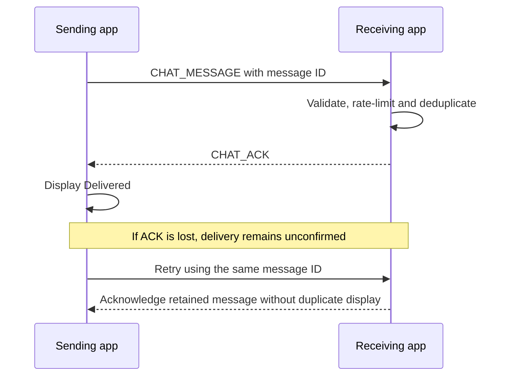

# Device chat

Device chat is direct human-to-human messaging over the authenticated peer session.
There is no AI service or separate cloud messaging connection. A client chats with
its host; the host selects one client conversation. Messages are not broadcast.

## Controls

- Drag the panel header, or focus it and use arrow keys; Shift moves it farther.
- Reset position, minimize, or press Escape to close the panel.
- Enter sends; Shift+Enter inserts a line break.
- Unread badges identify new messages. Use **Latest messages** when reading older
  content without wanting the view to jump automatically.
- Drafts remain when switching conversations within a page, but not after reload.

**Delivered** means the other app acknowledged acceptance, not that a person read
the message. An unconfirmed message can be retried using the same ID, enabling
deduplication within retained history.

History is in memory: up to 200 messages per peer. A retained peer can preserve
history across reconnect, but restarting/replacing the relevant application state
can clear it. No durable chat database or remote read receipt is promised.

Messages allow 2,000 characters and 8,000 UTF-8 bytes. Rate limiting permits 20 new
messages per ten seconds per direction. Text is rendered as text, not HTML.

## Delivery and retry



### Rules

Chat requires authentication and negotiated chat support. Correlation IDs must
not enter a file engine's data queue. A missing ACK is uncertainty, not proof of
nondelivery. Deduplication depends on retained history; it is not a permanent
exactly-once guarantee. Read counters stored by the UI are not peer read receipts.

| Limit or behavior | Value/scope |
| --- | --- |
| Text limit | 2,000 characters and 8,000 UTF-8 bytes |
| History | At most 200 messages per peer, in memory |
| Admission rate | 20 new messages per 10 seconds per direction |
| Visible/background polling | Approximately 1 second / 5 seconds |
| Draft retention | Per conversation within the current page |

## Verify

```powershell
python -m pytest tests/test_chat.py tests/test_chat_browser.py -q
node --test tests/queue.test.cjs
```

Backend tests include real TCP bidirectional chat while a receiver is busy,
lost-acknowledgement retry, reconnect history, peer isolation, API validation,
bounded history and capability gating. Browser tests cover movement, bounds,
position persistence, unread behavior, drafts, retry, safe text, themes, reduced
motion and real host/client messaging. Most layout cases mock HTTP; the native
browser exchange is separate. These checks do not establish native-window rendering
or durable message retention.
