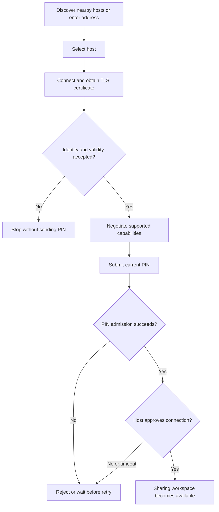

# Discovery and pairing

Discovery uses UDP to find reachable hosts. Available hosts appear as selectable
cards on the search/radar interface, with an address and name. Selecting a card
chooses the target; it does not authenticate it. Manual address entry remains
available when broadcasts do not cross network boundaries.

## Connection sequence

1. Select the host address.
2. Verify its full SHA-256 certificate fingerprint from the host display or another
   trusted channel. Do not trust discovery data as the fingerprint authority.
3. Establish TLS and validate the saved or supplied identity before sending credentials.
4. Submit the current single-use PIN.
5. Wait for the host to approve the connection.
6. Show connection success and enable the sharing workspace.

PINs rotate after use and expire according to configuration. A saved certificate
pin rejects an unexpected identity change. Reconnection still needs fresh pairing
and approval; recovery credentials do not replace identity checks.

Default ports are TCP 5000 for transfers, UDP 54545 for discovery, and loopback
HTTP 8765 for the local interface. Network isolation, VPNs, or firewall rules can
block discovery independently of direct TCP reachability.

## Connection decision flow



### Rules

Discovery names/IPs are hints, not a trust anchor. Verify identity before sending
credentials, keep the PIN private, and do not treat connection approval as upload
group approval. Repeated invalid attempts can be throttled even when the correct
PIN is subsequently entered.

## Verify

```powershell
python -m pytest tests/test_host.py tests/test_security_hardening.py tests/test_security_browser.py -q
```

Host tests cover correct/wrong PIN, immediate single-use invalidation, rejection,
approval timeout and peer isolation. Security tests check TLS fingerprint handling,
including refusal to send the PIN without an accepted identity. Browser checks
cover the fingerprint and permission UI; they do not validate physical-network
broadcast reachability or Windows firewall prompts.
