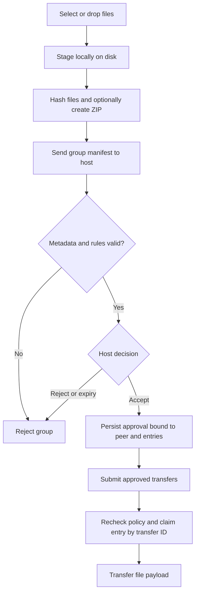

# Group approval

An upload selection or drop creates one group containing 1–100 files. The desktop
application requires one explicit host approval for that selection, rather than
one prompt per file. Selecting another group requires another decision.

The approval binds the peer, group identity, filenames, sizes, hashes and overwrite
policy. Each approved entry is claimed by a transfer identity. Retrying or recovering
that transfer preserves its identity instead of consuming an unrelated approval.
No selected file payload is transferred to the host before group acceptance.

## Decisions and expiry

- **Accept:** eligible files may enter transfer scheduling; rules are checked again.
- **Reject:** the client receives a rejection notice and can acknowledge it. The
  client must select files again to make another request.
- **Cancel:** stops the selection/preparation workflow and associated work as applicable.
- Pending requests expire after ten minutes. Unused approved entries expire after
  one hour.

Approved records are persisted. Pending local selections can survive a page reload
while the application remains running, but pre-submission preparation is not an
application-restart recovery guarantee.

Library integrations must explicitly enable `require_batch_approval=True` on
`TransferHost` to enforce the desktop application's gate. See [API reference](../02-Understand-and-integrate/API_REFERENCE.md).

## Selection workflow



### Rules and failure handling

| Condition | Required behavior |
| --- | --- |
| Selection changes after approval | Do not silently reuse approval for different metadata |
| Same entry is claimed by unrelated work | Reject duplicate ownership |
| Source hash or ZIP member differs | Fail integrity validation rather than publish it |
| Host rejects group | Show an acknowledgeable message; keep the session usable |
| Preparation is cancelled | Stop preparation and release unsubmitted scratch ownership |

## Verify

```powershell
python -m pytest tests/test_batches.py tests/test_cleanup_browser.py -q
```

Tests cover the strict approval gate, approved-group transfer, ZIP/non-ZIP flows,
tampered archive members, rejection/cancellation, and approval persistence. Browser
checks include real group approval and page-reload/cancelled-row behavior. Some
cleanup/layout cases mock HTTP; they are not independently real peer-transfer tests.
