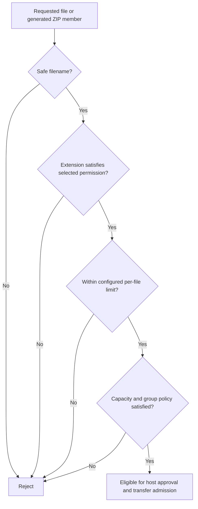

# Transfer rules

The host's File Transfer Rules panel controls eligible file extensions and maximum
file size. Its searchable multi-select supports checkboxes, removable chips and
custom extensions.

## Extension permission

- **Is allowed:** accept only selected extensions; select at least one.
- **Is not allowed:** reject selected extensions; an empty selection blocks none.

Matching is case-insensitive and supports custom compound suffixes such as
`.tar.gz`. Extension checks express a filename policy; they are not malware scanning
or proof of a file's internal type.

## Size limit

The slider and numeric MB/GB input represent the same value. The upper bound is
based on free space on the destination drive. The live summary reflects the chosen
permission, extensions and limit. Save to apply and persist the settings.

The maximum is per original file and, when applicable, the ZIP container—not the
sum of every file in a plain group. Available capacity is checked when saving and
approving groups, including other approved commitments. External programs can
consume space afterward, so these checks cannot guarantee future disk capacity.

Rules are enforced by the backend, not just disabled UI controls. Keep deletion
permission off unless the host intentionally grants it to approved clients.

## Policy evaluation



Eligibility is not automatic acceptance. User approval and transfer ownership
remain separate requirements. UI validation is advisory; the backend must repeat
checks even for requests made without the visible controls.

## Verify

```powershell
python -m pytest tests/test_rules_ui.py tests/test_batches.py tests/test_host.py -q
```

UI tests cover synchronized size controls, extension selection and policy feedback.
Batch/host tests cover disk limits, blocked extensions, oversized uploads and rule
changes affecting connected peers. These are not file-content malware tests or
proof that another program cannot consume disk space after approval.
