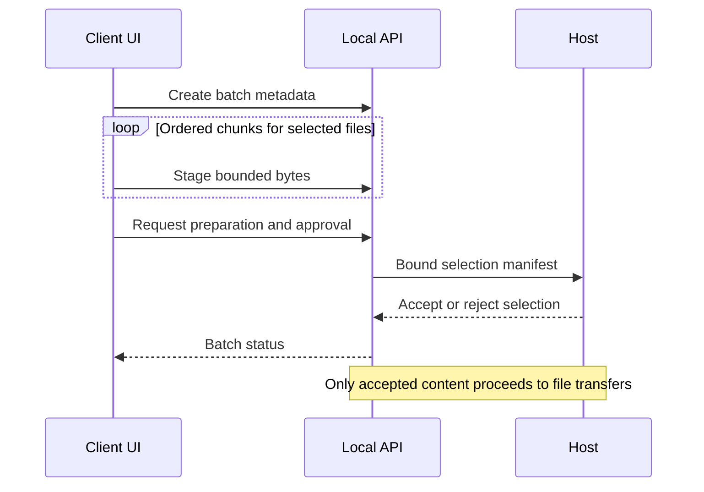

# Local API reference

The API is for the local desktop interface, not an unauthenticated public service.
Use the launch-established cookie, exact loopback Host, and matching Origin for
writes/WebSockets. Do not copy cookies or bootstrap tokens into shared scripts or logs.
Descriptions below are route-level guidance; consult the running application's
authorized OpenAPI schema for full request/response field definitions.

## Transfers

| Method | Route | Purpose |
| --- | --- | --- |
| POST | `/api/transfers` | Create an asynchronous upload/download |
| GET | `/api/transfers` | Client transfer snapshot |
| GET | `/api/transfers/{id}` | One authoritative resource |
| POST | `/api/transfers/{id}/{action}` | pause, resume, cancel, retry or recover |
| POST | `/api/transfers/actions/{action}` | pause_all, resume_all, cancel_all, retry_all or recover_all |
| GET | `/api/transfers/{id}/content` | Content of an eligible completed download |
| POST | `/api/uploads/{upload_id}/chunks` | Ordered bounded staging chunks |
| DELETE | `/api/uploads/{upload_id}` | Cancel staging or its handoff |

Upload metadata includes `direction`, `local_path`, and optional `overwrite`.
Download metadata includes `direction`, `filename`, and optional `dest_path`.
Direct transfer creation does not bypass a host's mandatory group approval.
Missing resources use 404, state conflicts 409, invalid inputs 422, and unavailable
link/storage conditions 503 on canonical resources as applicable.

## Selection workflow

| Method | Route | Purpose |
| --- | --- | --- |
| POST | `/api/client/batches` | Create selection metadata with `files` and `zipped` |
| PUT | `/api/client/batches/{batch_id}/files/{index}` | Stage file bytes; `chunk_index` and `final` query parameters |
| POST | `/api/client/batches/{batch_id}/request` | Start preparation/approval request |
| GET | `/api/client/batches` | Relevant outstanding selections |
| GET | `/api/client/batches/{batch_id}` | Selection status |
| DELETE | `/api/client/batches/{batch_id}` | Cancel selection |
| GET | `/api/host/batches` | Pending host decisions |
| POST | `/api/host/batches/{peer_id}/{batch_id}/{decision}` | `accept` or `reject` |

Group staging requests are capped at 4 MiB. The separate generic upload staging
route has an 8 MiB cap. Do not confuse their body limits or request contracts.

## Connection, host and chat

Host routes include POST `/api/host/start`, `/stop`, GET `/info`, `/pending`, `/peers`,
`/transfers`, `/files`, and GET/POST `/settings`. Approvals use
POST `/api/host/accept/{request_id}` or `/api/host/reject/{request_id}`.

Client routes include GET `/api/client/discover`, `/status`, `/files`, POST
`/api/client/connect`, `/disconnect`, and DELETE `/api/client/delete/{filename}`.
Connection input includes host, PIN and certificate fingerprint as required.
Deletion requires explicit host permission.

GET `/api/chat` obtains conversation state; POST `/api/chat/messages` sends a
message. See [Events](EVENTS.md) for transfer WebSockets. Transfer/event identifiers
must be treated as scoped application data, not authorization credentials.

## Request ordering and errors



| Condition | Consumer rule |
| --- | --- |
| Successful asynchronous creation | Track the returned resource; acceptance is not completed delivery |
| 404 | Refresh the relevant snapshot; do not manufacture a replacement identifier |
| 409 | Re-read current state before offering the next action |
| 422 | Correct the request; do not repeatedly retry unchanged invalid input |
| 503 | Surface link/storage availability and allow an explicit recovery decision |
| Network timeout after a mutation | Check authoritative status before resubmitting; do not assume every POST is idempotent |

Host decisions are scoped to both peer and batch. The separate group-staging and
generic-upload routes have different limits and are not interchangeable APIs.

## Verify

```powershell
python -m pytest tests/test_api_transfers.py tests/test_batches.py tests/test_security_hardening.py -q
```

These tests exercise resource validation, lifecycle actions, approval binding and
local access controls. Browser queue rendering and event ordering have separate
coverage in [Events](EVENTS.md) and [Testing](../03-Validate-and-operate/TESTING.md).
