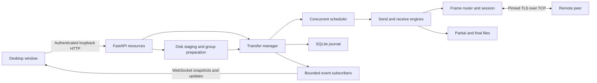

# Architecture

The desktop launcher starts a loopback FastAPI service, waits for readiness, and
opens a pywebview window. HTML/CSS/JavaScript is bundled locally. Peer file traffic
uses a separate TLS connection, not the local browser HTTP channel.

| Component | Responsibility |
| --- | --- |
| `webapp.main` | Backend startup, native window and shutdown |
| `webapp.api`, `batch_api` | Local resources, settings, browser staging and group workflow |
| `TransferHost` | Listening, pairing, peer ownership and host policy |
| `HostLink` | Client connection, trust, scheduler and recovery association |
| `Session`, `FrameRouter` | Framed connection and per-operation routing |
| `TransferManager` | Authoritative state and lifecycle events |
| `ConcurrentScheduler` | Admission, workers and transfer actions |
| `SendEngine`, `RecvEngine` | Chunks, acknowledgements, integrity and checkpoints |
| `PersistenceStore` | SQLite transfer/settings journals |
| `ChatChannel` | Bounded peer messaging, acknowledgement and deduplication |

The host has separate peer managers; one client link represents one host. Transfer
IDs identify work within a peer scope. Host-side UI keys include the peer identity
to prevent equal IDs from different peers colliding.

The browser is a view/controller, not a second scheduler. It requests operations,
consumes snapshots/events and stages local files. Disk writes, source preparation
and network work must not block the ASGI event loop.

See [Protocol](PROTOCOL.md), [Events](EVENTS.md) and [Storage](STORAGE_AND_RECOVERY.md).

## Component and trust boundaries



The local browser session and remote peer session authenticate different actors.
A valid UI cookie is not a peer credential; a peer PIN is not a local API cookie.
The host listener and UI server use different ports and exposure policies.

### Implementation rules

1. Transfer state is owned by the manager, not inferred independently by the UI.
2. Slot admission is owned by the scheduler, including resume and recovery.
3. A file-level failure must not terminate the healthy shared session deliberately.
4. Blocking disk/hash work must run outside the ASGI event loop.
5. Event subscribers must not make transfer threads wait for browser rendering.

## Verify

```powershell
python -m pytest tests/test_transfer_manager.py tests/test_scheduler.py tests/test_host.py tests/test_tls_reliability.py -q
```

These modules cover state enforcement, worker admission, multiple peer isolation,
control traffic during transfers, and concurrent TLS I/O reliability. They are
backend checks; browser and desktop-window acceptance are separate.
