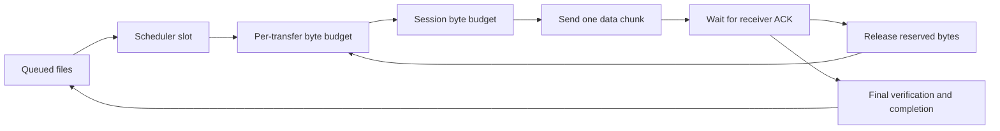

# Concurrency and flow control

Concurrency and buffering are separate controls. Scheduler slots limit active file
jobs; byte windows limit admitted transfer data. Each file still uses stop-and-wait
acknowledgements, even when several files progress concurrently.

| Control | Default |
| --- | --- |
| Client active transfers | 5 |
| Host active transfers per peer | 5 |
| Host live connection admission | 20, including incomplete handshakes |
| Chunk size | 1 MiB |
| Session/global byte window | 8 MiB |
| Per-transfer byte window | 2 MiB |

The window called global is session-wide, not a machine-wide memory quota across
all clients. WINDOW_UPDATE messages adjust available capacity. Negotiated sizes
must remain consistent with chunk and protocol limits.

The host's five slots are per peer; five clients can therefore generate more than
five active files in total. A client does not maintain simultaneous connections to
multiple hosts. Browser staging has a separate limit of three request pipelines;
it does not change peer transfer admission.

Constructor controls are `HostLink(max_concurrent=5)` and
`TransferHost(max_concurrent_per_peer=5)`. Byte-window defaults are configurable
through the environment. Raising concurrency can increase disk contention, memory,
threads and latency; benchmark before changing it. Window and queue limits are not
a proven aggregate resource-exhaustion defense against malicious approved peers.

## Admission and acknowledgement



The diagram separates file admission from data admission. A completed file frees a
scheduler slot; an acknowledged chunk frees byte capacity. Cancellation and errors
must also release reservations. A window reduction cannot revoke bytes already
sent: existing reservations must drain before new work fits the reduced allowance.

Rules for tuning:

- Treat the five-file limit as per-peer admission, not a machine-wide cap.
- Keep transfer and session reservations consistent; never allow a negative budget.
- Ensure a paused or cancelled waiter can exit without blocking unrelated files.
- Account separately for TLS buffers, browser staging, history and hashing memory.
- Retain durable acknowledgement semantics when comparing performance profiles.

The measured three-client equal-workload fairness index was 0.999951–0.999977 in
the recorded local run. See [Performance](../03-Validate-and-operate/PERFORMANCE.md) for workload and sampling
limits; this is not evidence of a machine-wide resource quota.

## Verify

```powershell
python -m pytest tests/test_flow_control.py tests/test_scheduler.py tests/test_pause_flow_race.py -q
```

Tests cover blocked acquisition, cancellation, shrinking/growing windows, reserved
byte debt, scheduler capacity and pause/window races. The opt-in local-load command
in [Performance](../03-Validate-and-operate/PERFORMANCE.md) adds multiple real clients; unit window tests alone
do not measure fairness or network throughput.
