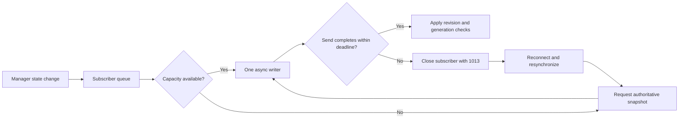

# Event delivery

`/api/transfers/events?side=client` and `?side=host` expose transfer synchronization
over authenticated WebSockets. Omitting `side` includes both roles. Invalid side
values are rejected. The activity-log socket is separate and is not transfer state.

## Synchronization contract

Each connection begins with `TRANSFER_SNAPSHOT`. Subscription is registered before
reading the snapshot to avoid a gap. Lifecycle and progress events carry transfer
state plus side, peer scope, stream/event identity, revision and generation metadata.

- Revision increases as state, progress or intent changes.
- Generation distinguishes reconstructed objects with the same transfer ID.
- Stream identity distinguishes backend process instances.
- Host row identity includes the peer, not just the transfer ID.

Consumers reject stale updates and reconcile snapshots with events already received.
REST snapshots remain an authoritative fallback. A requested resume is not proof
that data movement has already restarted.

## Backpressure and reconnect

Each subscriber has a bounded 128-message queue and one writer. Progress can be
coalesced without crossing a lifecycle boundary. Overflow requests a fresh snapshot;
a send stalled for five seconds disconnects that subscriber with code 1013.
The UI reconnects with bounded backoff and resynchronizes.

This is current-state synchronization, not a lossless event journal. Intermediate
events may be replaced by snapshots. Event IDs are not persistent replay cursors,
and queue limits do not bound the size of retained-history snapshots.

## Subscriber backpressure



### Consumer rules

Do not order transfers only by arrival time. An asynchronous REST response may
arrive after a newer WebSocket event. Use scoped identity, stream, generation and
revision together; reset the appropriate cache when stream identity changes.
Progress coalescing must not erase a lifecycle barrier. Never use this feed as
the only evidence for billing, legal audit or exactly-once external side effects.

## Verify

```powershell
python -m pytest tests/test_transfer_events.py tests/test_queue_browser.py -q
node --test tests/queue.test.cjs
python -m pytest -q -k "snapshot or websocket or revision"
```

Event tests validate manager-to-subscriber delivery. Queue/browser and Node tests
check stale responses and rendering behavior at their respective tiers. The
keyword selection adds matching snapshot, revision and WebSocket integration
cases; it does not imply every selected test uses a real browser or OS socket.
