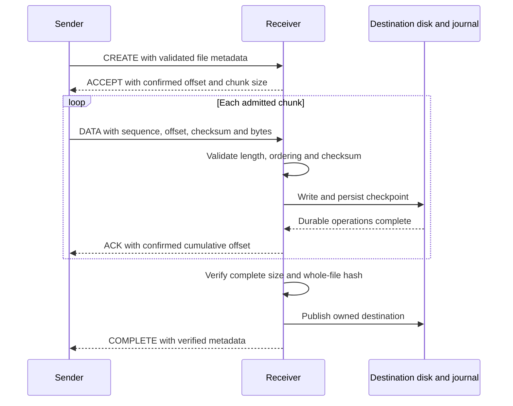

# Wire protocol

All peer operations use framed messages inside the desktop application's TLS
session. The wire codec is in `filetransfer/transport.py`; session negotiation is
in `filetransfer/session_protocol.py`. These are internal source references, not public
HTTP routes.

## Fixed header

Integers use big-endian byte order. The header is 48 bytes.

| Offset | Bytes | Field |
| --- | --- | --- |
| 0 | 4 | Magic `0x46543200` |
| 4 | 1 | Wire version selector |
| 5 | 1 | Frame type |
| 6 | 1 | Flags |
| 7 | 1 | Reserved, zero |
| 8 | 32 | Lowercase ASCII hexadecimal transfer/correlation ID |
| 40 | 4 | Unsigned sequence number |
| 44 | 4 | Unsigned payload length |

The zero ID is reserved for session-level traffic. Transfers require a nonzero
canonical ID; request/response operations also use IDs for correlation.

## Negotiation and message families

The current implementation supports wire selectors 2 and 3. HELLO/HELLO_ACK use
selector 2 for bootstrap, choose the highest mutually supported selector, and
intersect capabilities. Subsequent frames carry the selected value. An empty
intersection of supported wire selectors is an error. These values describe
currently implemented formats, not application release chronology.

| Codes | Purpose |
| --- | --- |
| `0x01–0x02` | HELLO and HELLO_ACK |
| `0x10–0x12` | AUTH, AUTH_OK, AUTH_FAIL |
| `0x20–0x29` | CREATE, ACCEPT, REJECT, DATA, ACK, PAUSE, RESUME, CANCEL, COMPLETE, ERROR |
| `0x2A–0x2B` | WINDOW_UPDATE and TRANSFER_RETRY |
| `0x30–0x31` | PING and PONG |
| `0x40–0x43` | File listing and deletion requests/responses |
| `0x44–0x45` | Chat message and acknowledgement |
| `0x46–0x49` | Group request, status, cancellation and response |

JSON controls must decode to objects. DATA carries encoded metadata and bytes;
it is not an unframed byte stream. Metadata includes offset and checksum. The
`FINAL_CHUNK` flag is `0x01`. Transparent compressed DATA is not offered; user ZIP
packaging is a separate feature.

## Validation and limits

The overall payload cap is 64 MiB; control and pre-authentication payloads are
bounded to 64 KiB. DATA metadata is bounded to 4 KiB, with negotiated chunks no
larger than 8 MiB. Defaults use 1 MiB chunks. These limits are different layers,
not a promise that every frame may carry a 64 MiB file chunk.

Unknown types/flag bits, malformed IDs, nonzero reserved bytes, invalid lengths,
truncated frames and assembly deadline failures are rejected. The reader retains
partial reads across polling timeouts; it does not scan corrupt bytes for a new
header. Invalid framing ends the connection. Transfer-semantic errors are isolated
where the framing remains trustworthy.

JSON rejects duplicate keys, non-finite values, invalid Unicode and nesting beyond
64 levels. Unsupported negotiated actions must not mutate transfer state.

## Data contract

CREATE validates direction, safe name, size, checksum, overwrite intent and chunk
size. ACCEPT supplies authoritative source metadata and confirmed resume offset.
ACKs are cumulative receiver-confirmed byte offsets. Selector 3 also correlates
DATA acknowledgements by sequence. One chunk per transfer is outstanding at a time.
Duplicate valid data is acknowledged without being written twice. COMPLETE is
accepted only with consistent size and integrity metadata.

## One chunk and completion exchange



This illustrates the application persistence path. A transport send completing
does not mean the receiver has acknowledged durable progress. The sender must
not advance its confirmed offset on an arbitrary future ACK or an early COMPLETE.

### Parser and semantic rules

| Layer | Rejects | Failure scope |
| --- | --- | --- |
| Header/frame reader | Bad magic, lengths, IDs, flags, reserved bytes, truncation | Connection framing is no longer trustworthy |
| JSON decoder | Ambiguity, non-finite numbers, invalid strings, excessive depth | Controlled frame error |
| Session negotiation | Unsupported selection or unoffered capability | Connection establishment rejected |
| Transfer engine | Wrong offsets, sizes, hashes or ownership | File failure where session framing remains valid |

The frame header's sequence is uint32. Creation rejects sizes/chunk choices that
would exceed its sequence space. Resume establishes a confirmed sequence epoch;
byte offsets remain authoritative. Duplicate data must match accepted ordering
and metadata—it is not permission to overwrite arbitrary destination ranges.

## Verify

```powershell
python -m pytest tests/test_session_protocol.py tests/test_chunk_ack_stress.py tests/test_security_adversarial.py tests/test_tls_reliability.py -q
python -m pytest -q -k "frame or negotiation or ack"
```

The named modules exercise negotiation, chunk integrity/stress, malformed JSON and
headers, and TLS stream reliability. The selection command includes additional
matching contract tests across the suite; pytest reports its actual collection.
The adversarial corpus performs 2,000 JSON mutations and 2,000 invalid-header
mutations inside tests, not 4,000 separate pytest cases. It is not exhaustive fuzzing.
