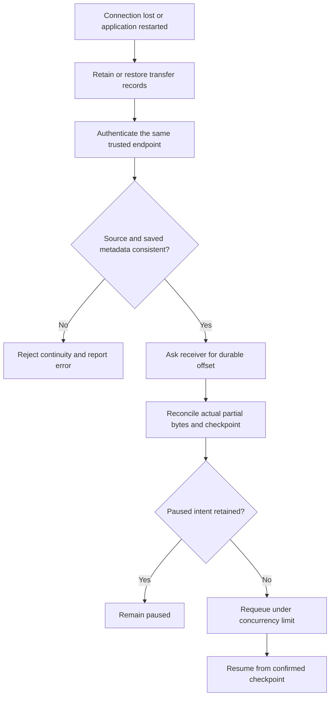

# Storage and recovery

Received chunks go to disk-backed, transfer-owned partial files in the destination
directory. Their names include destination-derived identity and transfer ID.
Reservations prevent concurrent writers from claiming the same final path.

## Durable progress

With application persistence enabled, data is flushed/fsynced and checkpoint state
is committed before the corresponding durable acknowledgement. SQLite uses WAL
and synchronous FULL. This ordering supports recovery; it does not guarantee
survival of faulty hardware, dishonest storage firmware, or every power-loss case.

Role journals default to `.ft-state` below the configured role directories. Settings,
peer scopes, transfer metadata and approved-group identity are retained. Windows
SQLite paths use extended-length syntax for scoped journals. Transfer journals are
not a substitute for backups of source and received content.

Normal operation can create these directories relative to the configured data paths:

```text
client_files/
└── .ft-state/
    └── client.sqlite3
server_files/
└── .ft-state/
```

The SQLite files store persistent application/transfer metadata used for recovery;
they are not copies of the transferred file contents. Additional peer-scoped
journals, SQLite WAL/SHM files and the host TLS identity can also be created.
Tests can initialize state as well. Their appearance is expected, even without
a completed file transfer.

Keep state files private and do not edit or delete them while the application is
running. Removing state can lose recovery information or saved identity.

## Recovery workflow

1. Keep source files and partial destinations available and unchanged.
2. Reconnect to the same trusted host endpoint with fresh PIN/host approval.
3. Attach the session to retained work.
4. Reconcile the receiver's checkpoint and resume eligible jobs under scheduler limits.

Paused jobs retain their paused intent. Restart recovery keeps transfer identities
rather than inventing unrelated uploads. Incomplete browser staging is not durable
across application restart; fully submitted transfers use the transfer journal.
Chat history is in memory and has different retention rules.

Do not manually delete partials, journals or host identity keys while work is active.

## Recovery decision flow



### Storage ownership rules

| Data | Owner/lifetime | Operator rule |
| --- | --- | --- |
| Original source | User or submitted app staging | Preserve while recovery/retry is possible |
| Unsubmitted staging | Selection workflow | Do not claim application-restart durability |
| Partial destination | One identified transfer | Do not merge with another transfer's bytes |
| Final destination | Successfully published content | UI dismissal must not delete it |
| Journal and TLS identity | Persistent role/peer state | Back up privately with matching content |

Recovery is not simply `seek(sender_offset)`. Unacknowledged bytes, a changed source,
an already-completed receiver or an inconsistent partial can all require different
handling. Full-file verification is still required before publication.

## Verify

```powershell
python -m pytest tests/test_retry_and_persistence.py tests/test_receiver_restart.py tests/test_reconnection.py tests/test_process_recovery.py tests/test_release_launcher.py -q
```

Coverage includes persisted records, offset reconciliation, sender/receiver restart,
connection-drop recovery and Windows scoped-journal paths. `test_process_recovery.py`
kills and restarts an actual host subprocess; other restart scenarios can reconstruct
objects in-process. These are distinct coverage modes, not equivalent claims.
