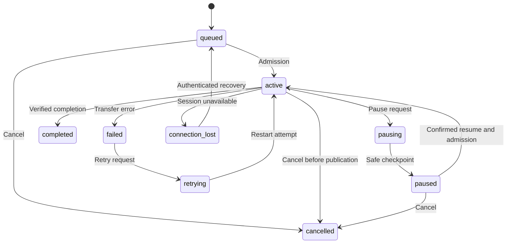

# Transfer lifecycle

The manager enforces legal transitions; callers cannot freely assign arbitrary
states to match the display. A transfer has an ID, direction, filename, total size,
confirmed offset, checksums, attempt metadata and event revision.

| State | Meaning |
| --- | --- |
| `queued` | Waiting for scheduler admission |
| `active` | Admitted for transfer work |
| `pausing` | Pause requested; a safe checkpoint is pending |
| `paused` | Work stopped at a confirmed checkpoint |
| `retrying` | An eligible failed attempt is being retried |
| `connection_lost` | Peer session unavailable; work may be recoverable |
| `completed` | Full content verified and completion committed |
| `failed` | Attempt failed; retry may be possible |
| `cancelled` | Explicitly stopped |

Typical progression is queued → active → completed. Pause passes through pausing
before paused. Resume may wait for a slot; a resume-request UI label is not a new
wire state. Retry is explicit and bounded where chunk-level retries occur.

Cancellation and final publication coordinate through transfer locking. Cancellation
before publication prevents later publication; a cancellation after committed
completion does not remove the file. A whole connection loss affects work carried
on that session; an isolated file failure does not deliberately close it.

Recovery reuses the transfer ID and negotiates the receiver's durable byte offset.
It must not assume the sender's last attempted write was received.

## Lifecycle overview



This is the main user-visible path, not the complete legal-transition table.
Completion can race pause, and connection loss can affect other nonterminal states.
The state machine in `transfer.py` governs those edges.

### State rules

Terminal display is not proof that every worker handle is already closed; cleanup
must coordinate with I/O termination. An offline Cancel must not falsely present
a successful live Resume. Queued recovery still consumes a slot when it becomes
active. COMPLETED content must not be silently changed by late cancellation.

## Verify

```powershell
python -m pytest tests/test_transfer_manager.py tests/test_pause_resume.py tests/test_pause_flow_race.py tests/test_reconnection.py -q
```

Checks include illegal transitions, repeated pause/resume, requests during worker
construction, paused cancellation, connection loss, retained completion and
recovery respecting concurrency. Use the full suite for cross-layer race coverage.
