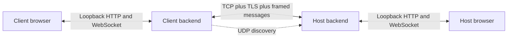
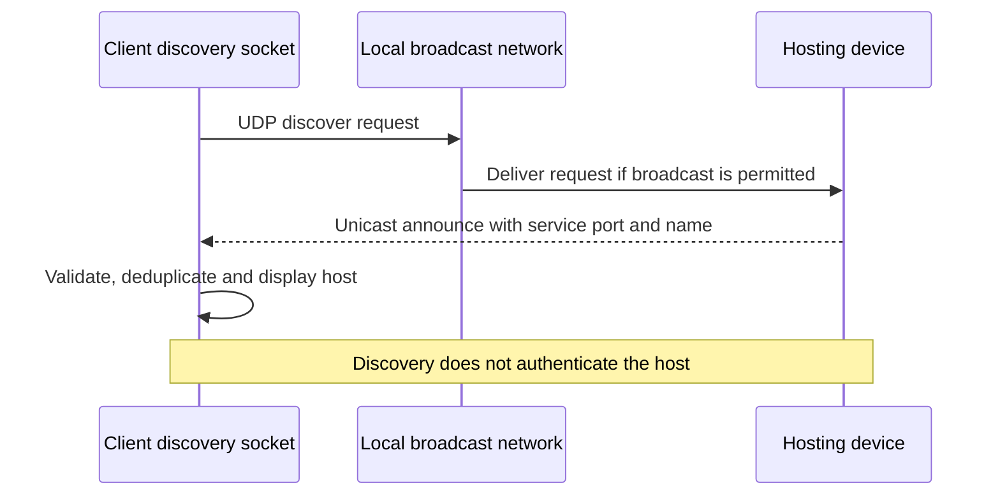
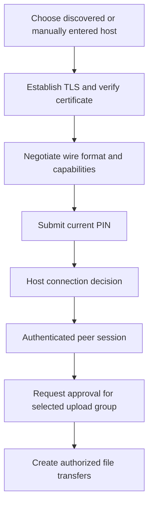
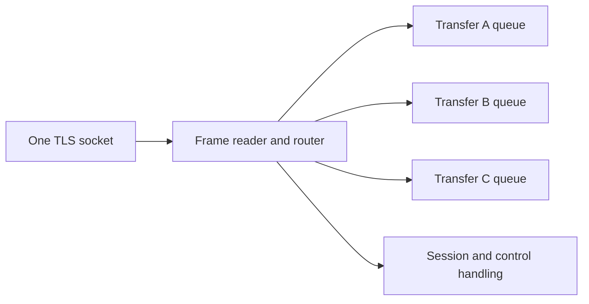
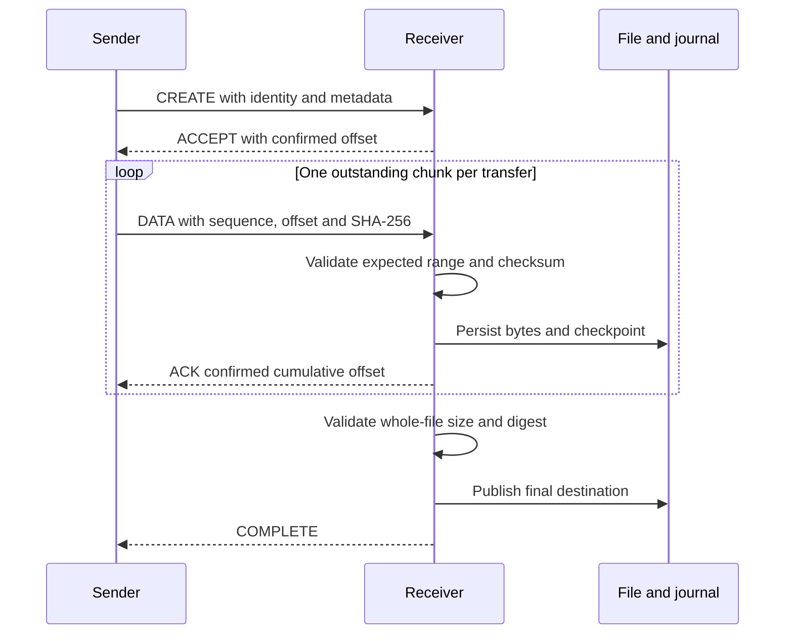
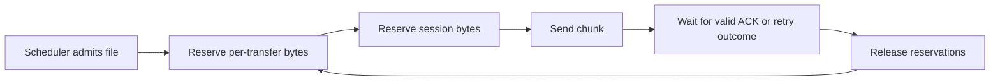

# Computer-Networking Concepts in the File Transfer Application

A code-grounded guide to discovery, sockets, TCP, TLS, framing, negotiation,
multiplexing, acknowledgements, flow control, recovery, HTTP and WebSockets.

## Scope and reading conventions

This standalone guide explains networking concepts used by the supplied project.
Source paths are relative to the application root. Commands run from that root.
Diagrams use Mermaid; accompanying explanations remain readable without rendering.
No application files are changed by this guide.

Implementation facts are distinguished from conceptual examples. TCP/IP theory
explains the operating environment, but the application does not implement TCP,
IP routing, Wi-Fi access control or a custom congestion-control algorithm.

Its peer protocol is implemented in `filetransfer/transport.py`,
`filetransfer/session_protocol.py` and `filetransfer/engine.py`. The local browser
interface uses a different HTTP/WebSocket surface under `webapp/`.

## Contents

1. Two communication planes
2. Layering and encapsulation
3. Addresses, ports, listeners and connections
4. LAN discovery over UDP
5. TCP as an ordered byte stream
6. TLS, certificate pinning and trust
7. Pairing and authorization
8. Application framing and validation
9. Negotiation and capabilities
10. Multiplexing and message routing
11. Chunk acknowledgements and integrity
12. Retry, idempotency and duplicate handling
13. Flow control and backpressure
14. Timeouts, keepalives and reconnection
15. HTTP, WebSockets and browser security
16. Chat and group approval as protocol workloads
17. Performance models and measured evidence
18. Testing, diagnosis and conceptual boundaries

## 1. Two communication planes

The application has two distinct network relationships:

1. **Local UI plane:** the desktop browser communicates with the local Python
   backend over loopback HTTP and WebSockets.
2. **Peer transfer plane:** a client backend connects to a host backend using
   TCP with TLS and application-defined frames.



A browser progress event is not a peer DATA frame. A successful local HTTP request
does not imply that a remote file is complete. Keeping these boundaries distinct
is essential when debugging latency, security or failed transfers.

The host can serve multiple clients. Each client link maintains one host
connection at a time. Multiple files between that pair share one peer session.
This is not a mesh network in which every device automatically connects to every
other device.

## 2. Layering and encapsulation

| Layer or service | Responsibility | Project relationship |
| --- | --- | --- |
| Ethernet/Wi-Fi | Delivery over the local physical network | Provided by OS, NIC and network infrastructure |
| IP | Addressing and routing packets | Used through ordinary sockets |
| TCP | Reliable ordered byte stream and congestion control | Carries the peer TLS connection |
| TLS | Encrypted, integrity-protected transport records and peer identity material | `tls_identity.py`, `tls_io.py` |
| Application frames | Message boundaries, types, transfer IDs and payload limits | `transport.py` |
| Session/transfer semantics | Negotiation, authentication, creation, ACKs and lifecycle | `session_protocol.py`, `engine.py` |
| UI API | Browser commands and event delivery | `webapp/api.py`, `webapp/events.py` |

The OSI model is a useful teaching framework, but real software does not always
fit perfectly into seven separate modules. TLS sits above TCP; the application
then imposes its own message structure above TLS. HTTP and WebSockets are another
application-level protocol family used on the local interface.

Encapsulation means each layer carries the bytes of the next layer. A single
file chunk may become multiple TLS records and TCP segments. Their boundaries
do not have to match the application's frame boundaries.

**Important consequence:** do not size application reads around assumptions about
Ethernet frames, TCP segment sizes or one-to-one TLS records.

## 3. Addresses, ports, listeners and connections

An IP address identifies a network endpoint location; a port identifies a
transport service on that endpoint. The combination of transport protocol and
port matters: TCP port 5000 and UDP port 5000 are different sockets.

Current defaults include:

| Endpoint | Default | Scope |
| --- | --- | --- |
| Peer TCP listener | Port 5000 | Intended private-network peer traffic |
| Discovery UDP listener | Port 54545 | Local discovery requests/replies |
| Local UI HTTP service | Port 8765 | Loopback desktop interface |

`0.0.0.0` is a wildcard bind address, not an address another machine should enter
as the destination. `127.0.0.1` refers to the current machine. A client on another
laptop must use the host's reachable network address, not its own loopback address.

### 3.1 Listening versus connected sockets

The host creates a listening socket, binds it and calls `listen()`. Accepted
connections receive separate sockets. The listening socket remains available
for additional clients.

An established TCP connection is identified by its endpoint tuple: source address,
source port, destination address and destination port, within the TCP transport.
Clients normally receive ephemeral source ports chosen by the OS.

The `listen()` backlog is not the same as the application admission limit. The
project separately checks live connections, including incomplete handshakes,
against its configured limit, which defaults to 20.

### 3.2 Why two nearby devices may not connect

Being physically close does not imply mutual IP reachability. Guest Wi-Fi can
isolate clients. Firewalls can block inbound TCP or broadcast UDP. VPNs and
multiple interfaces can change routing. Different subnets can prevent discovery
even when a manually addressed TCP connection is possible.

The application does not provide NAT traversal, STUN/TURN, a public rendezvous
service or automatic internet relay. A successful loopback test does not certify
any of those deployment conditions.

## 4. LAN discovery over UDP

### 4.1 Why UDP fits discovery

Before connecting, the client may not know a host's address. A small UDP broadcast
request can ask reachable local hosts to announce themselves without establishing
a separate TCP connection to every possible address.

`discovery.py` sends a JSON discovery request to `255.255.255.255` with
`SO_BROADCAST` enabled. It also probes `127.0.0.1` for same-machine discovery.
Responders reply directly to the requester's source address and port.



The response includes a friendly name, service port and whether a PIN is set—not
the PIN itself. The client derives the displayed endpoint IP from the datagram's
source address rather than trusting an arbitrary advertised IP field.

### 4.2 Datagram semantics

UDP preserves datagram boundaries, but does not guarantee delivery, ordering or
duplicate suppression. The application therefore collects responses for a finite
window and deduplicates discovered hosts by IP. A host may be reachable but absent
from one search because a request or reply was lost.

The source uses small receive buffers and validates message type, marker, port,
name length and collection size. The responder has per-source/global request
limits. These reduce accidental noise and some resource abuse; they do not turn
unauthenticated discovery into an identity protocol.

### 4.3 Broadcast is not mDNS

This project uses a custom UDP request/response exchange. It is not mDNS,
Bonjour, DNS-SD or a subnet-wide TCP scanner. Routers generally do not forward
limited broadcasts between networks. Manual address entry remains important.

**Security rule:** treat discovery as a list of candidates. A malicious device
can advertise a convincing name. Identity must be checked during secure pairing.

## 5. TCP as an ordered byte stream

### 5.1 What TCP supplies

TCP provides ordered delivery of a stream of bytes, retransmission of lost
segments, duplicate handling at the transport layer and flow/congestion control.
It does not provide file metadata, transfer IDs, checksums of published files,
host approval or a “message received by the application” guarantee.

The conceptual TCP connection setup uses SYN, SYN-ACK and ACK. The operating
system implements that exchange; application code calls `connect()` and
`accept()` rather than constructing handshake packets.

### 5.2 Partial reads and combined reads

If a sender writes a 48-byte header followed by a payload, the receiver may see:

```text
read 1: 13 header bytes
read 2: 35 remaining header bytes and some payload bytes
read 3: remaining payload bytes
```

It may also receive bytes from more than one application frame in available
socket buffers. The parser must accumulate exactly the required bytes and retain
partial state across polling timeouts. One `recv()` is not one application message.

### 5.3 A successful send is not durable delivery

`sendall()` succeeding means the local send operation accepted the bytes according
to the socket API. It does not mean the remote application validated or stored
them. A TCP ACK means the remote transport stack acknowledged stream data; it
does not mean SQLite committed a transfer checkpoint.

If a frame write fails after some bytes were transmitted, the sender may not know
where the receiver stopped. Sending another frame onto that uncertain stream can
make subsequent bytes look like the unfinished payload. The session is therefore
not reused after an uncertain partial-frame send failure.

## 6. TLS, certificate pinning and trust

### 6.1 Encryption is only one part

TLS protects connection records against network reading and modification when
properly established. It does not decide whether a user should trust a particular
device name, nor does it prevent an authenticated peer from sending an unwanted
but correctly encrypted file.

The desktop application requires TLS. The host persists a self-signed elliptic-
curve identity. The client verifies the full SHA-256 certificate fingerprint,
checks validity and rejects unexpected changes to saved pins.

A fingerprint is a digest identifying a particular certificate. It is not a
password and does not establish trust merely by being displayed. The user must
compare it through a trusted channel, such as directly checking the host screen.
Copying the fingerprint from an untrusted discovery response would defeat that
out-of-band trust step.

### 6.2 Pinning versus public certificate authorities

Public web browsers commonly validate a hostname through a trusted CA chain.
This LAN application uses certificate pinning for its self-signed host identity.
An internal TLS context setting by itself is not the whole trust policy: the
explicit fingerprint/validity checks in `tls_identity.py` are crucial.

Keep the host identity file private and stable. Replacing it changes the
certificate fingerprint. A mismatch should trigger investigation, not automatic
acceptance or a recommendation to disable checks.

### 6.3 Concurrent TLS operations

The peer connection can carry traffic in both directions. `TLSIO` serializes
entry into the shared SSL object while permitting readiness waits outside the
lock. It uses nonblocking operations and handles both WANT_READ and WANT_WRITE.

This is not an alternative encryption protocol. It is careful scheduling around
the TLS library so multiple application threads do not misuse one connection.
See the operating-systems guide for the lock and readiness details.

## 7. Pairing and authorization



These steps solve different problems:

| Mechanism | Question answered |
| --- | --- |
| Address/discovery | Where might a host be reachable? |
| Certificate pin | Is this the expected host identity? |
| PIN | Does the connecting party possess the current pairing value? |
| Host connection approval | Does the operator admit this peer now? |
| Group approval | Does the operator accept this selected content? |
| File rules | Is the requested transfer permitted by policy? |

PINs are single-use, expire under configured policy and have bounded admission
attempts. The defaults include five attempts per source and sixty globally per
minute; successful attempts count too. These are application controls, not
TCP congestion controls.

Connection approval does not automatically approve every future file selection.
Likewise, group approval is not permission to alter the manifest or transfer
arbitrary paths. Authorization must remain bound to peer, selection and content.

## 8. Application framing and validation

### 8.1 Why a header is necessary

TCP gives bytes, not typed operations. `transport.py` adds a fixed 48-byte header:

| Offset | Width | Field | Purpose |
| --- | --- | --- | --- |
| 0 | 4 bytes | Magic | Recognize the expected framing format |
| 4 | 1 byte | Wire selector | Identify negotiated format |
| 5 | 1 byte | Message type | DATA, ACK, CREATE, control operation, etc. |
| 6 | 1 byte | Flags | Defined options such as final-chunk marker |
| 7 | 1 byte | Reserved | Must satisfy the codec's validation rules |
| 8 | 32 bytes | Transfer/correlation ID | Route work to the correct logical operation |
| 40 | 4 bytes | Sequence | Correlate ordered chunk/control semantics |
| 44 | 4 bytes | Payload length | Know how many body bytes to read |

Integers use big-endian byte order. That avoids depending on the CPU's native
integer representation. IDs use canonical ASCII hexadecimal representation;
the zero ID is reserved for session-level traffic.

### 8.2 Layered size limits

| Limit | Value | Reason |
| --- | --- | --- |
| Overall frame payload | 64 MiB | Absolute codec bound |
| Control/pre-authentication payload | 64 KiB | Restrict inexpensive-looking control traffic |
| DATA metadata | 4 KiB | Bound JSON/control overhead within data messages |
| Maximum negotiated chunk | 8 MiB | Bound a single chunk |
| Default chunk | 1 MiB | Current transfer profile |

A 64 MiB frame cap does not mean every message type may use 64 MiB. Validation
must apply the narrowest relevant limit before reading or allocating a claimed
body. Otherwise a tiny malicious header could trigger a large memory allocation.

The codec rejects malformed magic, lengths, IDs, flags, reserved bytes and
truncation. JSON controls reject ambiguous duplicate keys, non-finite numbers,
invalid Unicode and excessive nesting. Framing validity is separate from semantic
validity: a correctly encoded ACK can still contain an impossible offset.

### 8.3 Failure scope

If framing is corrupt, the receiver cannot safely guess where the next frame
starts. The connection is terminated rather than scanning arbitrary bytes for
the magic marker. If framing is valid but one transfer has a checksum or policy
error, that failure can usually remain local to the transfer.

This distinction is what makes shared connections usable without pretending
that every error can be isolated independently of the transport.

## 9. Negotiation and capabilities

Peers exchange HELLO and HELLO_ACK to select a mutually supported wire format
and intersect feature capabilities. Current wire selectors include 2 and 3;
bootstrap negotiation uses selector 2. These are protocol identifiers, not
project-development history.

The selected format must be supported by both peers. The agreed feature set
cannot contain capabilities offered by only one peer. An empty format
intersection is an error, not permission to improvise a third format.

Capability gating matters for optional operations. A sender must not transmit
an unsupported operation simply because it knows how to encode the frame.
Features such as scoped windows and retry behavior need agreed semantics.

Version negotiation is also not authentication. An attacker can truthfully claim
to implement a protocol. Trust and authorization remain separate checks.

## 10. Multiplexing and message routing

Multiplexing carries several logical conversations through one physical session.
Each transfer has an ID; `FrameRouter` routes frames to per-transfer queues.
Session-level operations and correlated control requests have their own handling.



One reader owns stream consumption. Multiple transfer workers must not each call
`recv()` independently: one worker could consume another transfer's header or
payload. On the sending side, a session send lock prevents two frame writes from
interleaving their bytes.

Multiplexing reduces connection setup overhead and supports several active files.
It does not eliminate **head-of-line blocking**. TCP must deliver bytes in order,
so a lost segment can delay later bytes belonging to other transfers. A large
frame also occupies the shared stream while being sent.

This is application multiplexing over TCP, not independent QUIC streams. Cancelling
one transfer leaves the session open, but losing the session affects every active
transfer that depends on it.

## 11. Chunk acknowledgements and integrity

### 11.1 Two kinds of acknowledgement

| ACK layer | What it confirms | What it does not confirm |
| --- | --- | --- |
| TCP | Transport received stream bytes | File correctness, application acceptance or durable disk progress |
| Transfer protocol | Validated receiver-confirmed byte offset | Completion of every other transfer or unlimited future capacity |

The receiver validates each chunk's sequence/offset and SHA-256 digest. The
application persistence path writes and synchronizes data, commits the checkpoint
and then acknowledges progress. The sender advances its confirmed position from
valid ACKs, not merely from bytes accepted by the local socket.



### 11.2 Stop-and-wait

Each transfer sends one chunk and waits for its acknowledgement before advancing.
Several transfers can operate concurrently, but a single file does not have a
multi-chunk pipeline. This simplifies outstanding-range tracking and retry logic
at the cost of latency sensitivity.

An ACK cannot legitimately jump beyond data the sender has made available. A stale
ACK cannot roll progress backward. Correlation and sequence rules distinguish
current acknowledgements from delayed replies associated with another attempt.

### 11.3 Why SHA-256 if TLS already checks integrity?

TLS protects data while carried by the connection. File-level hashing verifies
the intended chunk/file content across staging, reads, application processing,
retries and final storage. Whole-file verification additionally catches incorrect
assembly, missing ranges or content mismatch that per-frame transport integrity
alone does not express.

A hash is not a malware detector. An approved malicious file can have a perfectly
valid SHA-256 digest. Content policy and operator decisions remain necessary.

## 12. Retry, idempotency and duplicates

Lost application acknowledgements create ambiguity: the receiver may have written
a chunk even though the sender did not see the ACK. Retrying must not append the
same bytes twice or overwrite an unrelated range.

The protocol identifies chunk position and checks duplicate data against accepted
state. Valid duplicates can be acknowledged without writing them twice. Retry
requests are constrained to valid outstanding ranges and sequence context.
The implementation bounds chunk retries; whole-transfer retry is a separate
lifecycle operation.

**Idempotency** means repeating an operation has the same intended effect as
performing it once. It does not mean all operations are automatically safe to
repeat. A timed-out POST or uncertain transfer creation should be reconciled
against authoritative state before blindly creating another operation.

Exactly-once delivery is a stronger claim than these mechanisms justify. The
project combines bounded retries, identifiers, duplicate handling and durable
progress. Chat has bounded in-memory history, while transfer recovery uses
persistent metadata; their duplicate-handling lifetimes are not identical.

## 13. Flow control and backpressure

### 13.1 Three distinct controls

| Mechanism | Protects against | Implemented by |
| --- | --- | --- |
| TCP receive window | Overrunning remote TCP receive buffers | OS TCP stack |
| TCP congestion control | Injecting excessive traffic into the network path | OS TCP stack |
| Application byte windows | Admitting more outstanding file work than application budgets permit | `flowcontrol.py` and protocol messages |

Application windows do not replace TCP congestion control. They can account for
work TCP cannot see, such as checksum validation and durable checkpointing.

The project defaults to an 8 MiB session-wide budget and 2 MiB per-transfer budget.
The “global” window is global to a session, not to all clients on a machine.
WINDOW_UPDATE adjusts advertised capacity; a reduction preserves outstanding debt
until previously admitted work drains.



Increasing a window alone does not make one file pipeline multiple chunks.
Increasing transfer concurrency can hide wait time across files, but can also
increase disk contention, thread activity and aggregate resource use.

The flow-control limits are not a comprehensive resource-exhaustion defense
against every authenticated malicious workload. Queue entries, file staging,
peer admission, histories and filesystem capacity have separate costs.

## 14. Timeouts, keepalives and reconnection

Network silence is ambiguous. A peer may be slow, busy, disconnected, suspended
or unreachable through a failed route. Timeouts convert indefinite uncertainty
into a bounded operational decision; they cannot prove the remote machine died.

The application uses read/write deadlines and application keepalive messages.
PING/PONG exchanges provide protocol-level liveness evidence. Default keepalive
settings include a two-second interval and ten-second timeout, subject to
configuration. These are not a guarantee of exact wall-clock detection under
every scheduler load.

When a session is lost, active transfers can enter `CONNECTION_LOST`. Recovery
creates a new trusted session, validates saved transfer metadata and reconciles
the receiver-confirmed offset. It is not continuation of the same broken TCP
stream and is not automatic restoration of every ephemeral UI operation.

Paused intent is different from active work interrupted by a drop. Recovery
should not unexpectedly turn intentionally paused files into running transfers.
An offset supplied by one peer must still be checked against the other peer's
identity, file metadata and actual durable state.

## 15. HTTP, WebSockets and browser security

### 15.1 HTTP resources

The browser uses local API resources such as `/api/transfers`. Creation can be
asynchronous: the API accepts and schedules work, returns an identifier and lets
the UI observe later completion. A 202 response is not a successful file hash.

| Response category | Meaning for the UI |
| --- | --- |
| Accepted asynchronous work | Track the returned resource |
| 404 | Resource is missing; refresh authoritative state |
| 409 | Requested action conflicts with current lifecycle state |
| 422 | Input is invalid; unchanged retries will not correct it |
| 503 | Required link/service/storage is unavailable |

The group-staging route caps each request at 4 MiB; the generic upload-staging
route has an 8 MiB cap. These HTTP body limits are distinct from peer chunk sizes.
Browser staging can finish before the host approves or receives the transfer.

### 15.2 WebSocket events

WebSockets provide a persistent browser/backend channel for lifecycle updates.
They are not the same as the peer TCP session. A browser may reconnect its event
socket while the backend's peer transfers continue.

The UI reconciles snapshots, revisions and generations so delayed events do not
overwrite newer state. Bounded subscriber handling prevents a slow browser from
blocking transfer workers indefinitely. Overflow recovery relies on current
snapshots rather than pretending every historical event is durably replayable.

### 15.3 Loopback is not automatic authorization

The desktop launcher establishes an authenticated local UI session using a
one-use bootstrap mechanism. Host/Origin checks and an HttpOnly, SameSite=Strict
cookie protect local endpoints and WebSockets against inappropriate browser use.

Loopback binding reduces remote exposure, but a malicious website can still
attempt requests to local services. Therefore “it runs on localhost” is not a
replacement for authorization. Do not publish the UI port through a reverse
proxy or bind it openly merely to share the desktop interface.

## 16. Chat and group approval as protocol workloads

Chat illustrates that one session carries more than bulk bytes. Messages use
correlation and acknowledgements, bounded retries and duplicate handling. The
implementation limits text to 2,000 characters and 8,000 UTF-8 bytes, retains
bounded in-memory history and rate-limits new messages. Character count differs
from byte count because Unicode encoding is variable-length.

Private host/client conversations are scoped to a peer. A host receiving several
clients must not accidentally route one client's messages to another. Sharing a
TCP listener does not imply sharing authorization or conversation state.

Group approval uses metadata for a selected set of files. The host decides once
for that group, while individual transfers retain their own IDs, checksums and
lifecycle. Generated ZIP packaging is a preparation feature, not transparent
compression of every DATA frame. ZIP contents must satisfy the applicable group
policy; received ZIPs are not automatically extracted.

## 17. Performance models and measured evidence

### 17.1 A stop-and-wait model

Let `C` be chunk bytes, `R` network round-trip time and `D` receiver processing/
durability time. A simplified single-transfer bound is:

```text
throughput ≈ C / (R + D + other per-chunk work)
```

For a conceptual 1 MiB chunk and 50 ms total per-chunk wait, the idealized ceiling
is about 20 MiB/s, ignoring transmission time and other overhead. That is a
teaching example, not a measured result for this application.

The bandwidth-delay product estimates bytes required in flight to fill a path:

```text
BDP = bottleneck bandwidth × round-trip time
```

At a conceptual 1 Gbit/s and 50 ms RTT, BDP is about 6.25 MB, or 5.96 MiB. One
1 MiB outstanding chunk cannot alone keep that path fully occupied. Several
concurrent files can overlap waiting, but they share the same TCP stream and
storage resources. A larger window is useful only if the sending algorithm can
actually exploit the capacity.

### 17.2 Units and timing boundaries

Network links are often described in bits/s; file benchmarks often use bytes/s.
One byte is eight bits. MiB means 1,048,576 bytes, whereas MB means 1,000,000.
Always state whether timing includes hashing, staging, ZIP creation, operator
approval, network transfer and final verification.

### 17.3 Recorded local results

The recorded full-suite XML at `outputs/r721/python.xml` contains these observations:

| Workload | Observation | Limitation |
| --- | --- | --- |
| Three clients, each five 16 MiB files, five rounds, 10 ms synthetic ACK delay | 75 files; client completion times 1.722–3.655 s | Equal local workloads, not physical-network fairness |
| Same fairness workload | Maximum within-round completion spread 61.43 ms | Completion sampling approximately every 20 ms |
| Same workload | Jain completion-rate index 0.999951–0.999977 | A summary of this workload, not a scheduling guarantee |
| Persistent session, five 8 MiB files per round | 167 rounds, 835 files, 6,680 MiB over about 180 s | Aggregate throughput exercise, not one 10 GiB file |
| Client browser during five 128 MiB uploads and 50 ms ACK delay | Median action latency 306.85 ms; max 680.05 ms | Ten instrumented theme/refresh actions |
| Host browser under equivalent load | Median action latency 384.38 ms; max 810.90 ms | Separate browser case on the same machine |

For equal workloads, Jain's index uses measured rates `x_i`:

```text
J = (sum(x_i))² / (n × sum(x_i²))
```

Near one means the measured rates were similar. It does not prove fair allocation
to clients with different file sizes, wireless signal quality or RTTs.

These report artifacts are not bundled with this guide and were not rerun for
its creation. Real LAN/Wi-Fi measurements, a single 10 GiB transfer, cold-cache
storage and long endurance remain separate evidence requirements.

## 18. Verification and troubleshooting

### Verify protocol contracts

```powershell
python -m pytest tests/test_session_protocol.py tests/test_transfer_contracts.py tests/test_chunk_ack_stress.py -q
python -m pytest tests/test_tls_reliability.py tests/test_reconnection.py tests/test_native_integration.py -q
python -m pytest tests/test_chat.py tests/test_chat_browser.py tests/test_batches.py -q
python -m pytest tests/test_security_hardening.py tests/test_security_adversarial.py tests/test_security_browser.py -q
node --test tests/queue.test.cjs
```

The tests cover frame boundaries, negotiation, ACK validity, retries, actual local
TCP/TLS sessions, recovery, chat and authorization. Some browser tests mock HTTP;
native browser exchanges are explicitly separate. A Node DOM adapter does not
test real browser rendering or network behavior.

For restricted socket-pair contract checks only:

```powershell
python tools/verify_protocol.py --memory-transport
```

That substitutes an in-memory byte stream where supported. It does not exercise
TCP listeners, TLS transport, physical networking or a native desktop window.
The naming-cleanup check collected 721 cases and passed 191 focused in-memory
Python checks plus 34 Node cases. Its native socket-pair attempt timed out; do
not represent that check as a complete native-network revalidation.

For local load measurements:

```powershell
$env:FT_LOCAL_LOAD='1'
$env:FT_BENCHMARK_UPLOAD='1'
python -m pytest tests/test_local_load.py tests/test_performance_upload.py -q -o junit_family=xunit1 --junitxml=network-load-results.xml
Remove-Item Env:FT_LOCAL_LOAD
Remove-Item Env:FT_BENCHMARK_UPLOAD
```

Use a fresh report filename. Real local networking, development dependencies and
Chromium are required for the applicable cases. These runs are not physical-LAN
benchmarks simply because they use TCP.

### Diagnose by layer

| Symptom | First boundary to inspect | Do not conclude |
| --- | --- | --- |
| Host absent from search | UDP broadcast, firewall, responder state | The host cannot accept a manual TCP connection |
| TCP connect fails | Address, listener, port, routing and firewall | The certificate is necessarily wrong |
| Fingerprint mismatch | Host identity and trusted comparison | Verification should be disabled |
| PIN rejected | Current PIN, expiry, single use and attempt limits | Encryption failed |
| Group waits indefinitely | Host decision and selection state | DATA frames are necessarily being dropped |
| File progress stops | ACKs, byte budgets, disk work and worker state | Increasing concurrency will solve it |
| UI stale but transfer continues | Local WebSocket and snapshot reconciliation | Peer TCP connection is dead |
| One large file slow | RTT, stop-and-wait, hashing and durable writes | Link speed alone predicts application throughput |

If using packet capture for an authorized test, expect TLS peer payloads to be
encrypted. Packet timing and endpoint metadata can still be sensitive. Do not
disable TLS to make a capture easier, and do not share private keys, PINs, cookies
or bootstrap URLs in diagnostics.

## 19. Concepts present, related, and absent

| Concept | Status in this application |
| --- | --- |
| Client/server communication | Implemented through host and client backend roles |
| TCP reliability and congestion control | Supplied by the operating system |
| UDP discovery | Custom LAN broadcast/request-response implementation |
| TLS certificate pinning | Implemented for peer identity verification |
| Typed application framing | Implemented above TLS |
| Multiplexing | Multiple transfers share one connection |
| File-level ACK and bounded retransmission | Implemented above TCP |
| Sliding-window pipeline within one file | Not implemented; each file uses stop-and-wait |
| HTTP/WebSocket local UI | Implemented separately from the peer protocol |
| QUIC, HTTP/3 or independent transport streams | Not the peer transport |
| mDNS/DNS-SD discovery | Not used by the custom discovery exchange |
| NAT traversal or public relay | Not provided |
| Transparent wire compression | Not offered; optional ZIP preparation is separate |
| Durable replay of every UI event | Not provided; snapshots synchronize current state |

## 20. End-to-end mental model

Discovery finds a candidate address, not a trusted identity. TCP establishes an
ordered stream, not a file transaction. TLS protects that stream and exposes
identity material for pin verification. Negotiation establishes mutually understood
formats and capabilities. Pairing admits a peer, while group approval admits a
specific selection. Framing and routing separate concurrent operations. DATA,
checksums, durable checkpoints and ACKs establish confirmed file progress. Flow
control bounds outstanding work; timeouts and recovery handle uncertainty. HTTP
and WebSockets present this state to the local user without being confused with
the peer transport itself.

The strength of the design comes from these layers having explicit responsibilities.
No single layer provides every guarantee, and a failure at one layer must be
diagnosed at the right boundary rather than hidden by a successful operation at
another.
