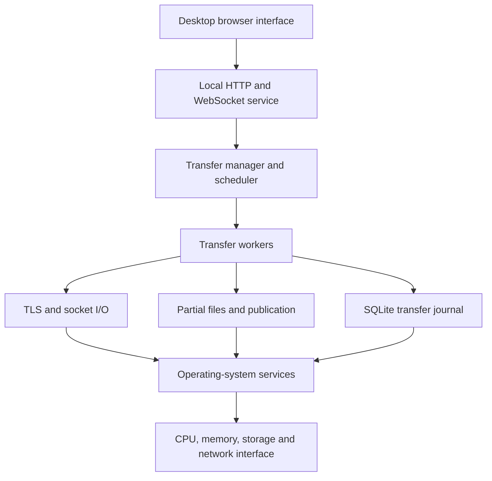
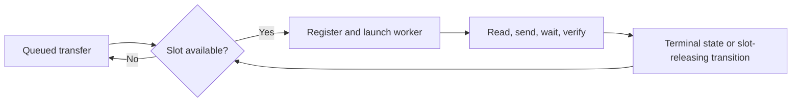
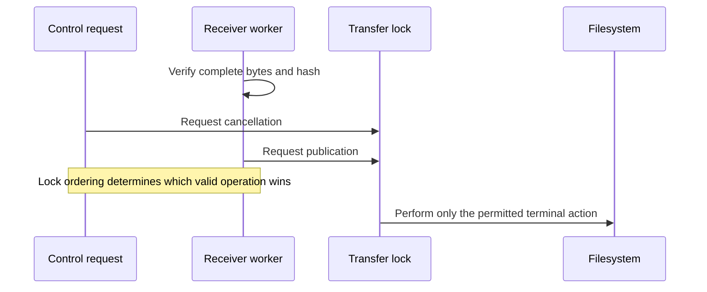
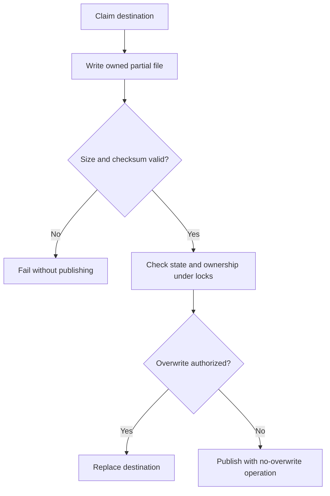

# Operating-System Concepts in the File Transfer Application

An implementation-focused guide to processes, threads, synchronization, memory,
filesystems, durability, asynchronous I/O, resource ownership and recovery.

## How to read this guide

This guide describes the supplied application's current source structure. Paths
such as `filetransfer/engine.py` are relative to the project root. Commands must
run from that root, not from the directory containing this guide. The guide is
standalone; it does not change application code or configuration.

**Implemented behavior** describes code in this project. **Conceptual examples**
explain the underlying OS idea and are not additional implementation claims.
Mermaid diagrams require a compatible Markdown reader. Every diagram also has
an accompanying prose explanation.

The application is not an operating system. It uses OS services through Python,
SQLite, TLS libraries, the web server and the desktop browser environment.
It does not implement virtual memory, a filesystem driver or a kernel scheduler.

## Contents

1. Architecture and the OS boundary
2. Processes, threads and concurrency
3. Application scheduling versus OS scheduling
4. Shared state, locks and race conditions
5. Condition variables, events and semaphores
6. Deadlock avoidance and lock scope
7. Blocking, nonblocking and asynchronous I/O
8. Memory, buffering and backpressure
9. File descriptors, handles and ownership
10. Partial files, atomic publication and path safety
11. Durability and SQLite transactions
12. Cancellation, pause and shutdown
13. Crash recovery and persistent identity
14. Permissions and process isolation
15. Performance interpretation and verification

## 1. Architecture and the OS boundary



The UI requests operations; managers track their state; schedulers admit work;
workers move and verify bytes. The OS provides execution contexts, sockets,
file handles, timers and storage operations. A successful high-level operation
depends on several of these resources remaining consistent.

For example, “cancel a transfer” is not merely changing a status string. It can
require waking a waiting worker, stopping further writes, closing a handle,
removing a transfer-owned partial file and publishing a final event.

| OS-related concept | Project location | Practical purpose |
| --- | --- | --- |
| Thread coordination | `scheduler.py`, `engine.py`, `host.py` | Multiple transfers and peer sessions progress independently |
| Lock-protected state | `transfer.py`, `manager.py` | Lifecycle transitions remain consistent |
| Condition variables | `flowcontrol.py` | Workers sleep while byte budgets are unavailable |
| Bounded preparation | `webapp/batch_api.py` | Limit simultaneous hashing/ZIP preparation work |
| Nonblocking readiness | `tls_io.py` | Wait for network readiness without monopolizing the TLS lock |
| File ownership | `transferfiles.py` | Prevent competing writers from claiming the same destination |
| Durable metadata | `persistence.py` | Restore recoverable state after restart |
| Process startup | `webapp/main.py`, `launch.py` | Establish the local service and desktop interface |

## 2. Processes, threads and concurrency

### 2.1 A process is a resource and protection container

A process has its own virtual address space and OS-managed resources. Python
objects belonging to the application disappear when that process exits. An
in-memory transfer manager, lock or chat history cannot survive a restart simply
because the destination file still exists.

The desktop environment may involve browser/runtime helper processes. The exact
process layout depends on the desktop backend. Do not assume that every visible
window, transfer or browser component corresponds to one Python process.

Tests can also launch separate processes. A subprocess restart test is stronger
evidence for loss of Python memory than reconstructing an object in the same
interpreter. It is still not identical to sudden hardware power loss.

### 2.2 Threads share resources

Threads within a process share ordinary Python objects and many process-owned
resources. This makes communication convenient but introduces races. A worker,
API handler and scheduler callback may all refer to the same transfer object.

The application uses threads for tasks such as accepting peers, routing frames,
executing transfer engines and collecting discovery responses. Thread scheduling
is not deterministic: the OS can interrupt one thread between two statements.

Suppose a worker performs:

```text
check that transfer is active
write next chunk
```

An API thread might request cancellation between the two operations. Correctness
requires a defined synchronization boundary; it cannot depend on the statements
usually running close together.

### 2.3 Concurrency is not necessarily CPU parallelism

Concurrency means multiple activities are in progress. Parallelism means work
executes simultaneously on separate CPU resources. Network and disk waits make
threads useful even when Python bytecode execution is constrained.

On a conventional GIL-enabled CPython build, the global interpreter lock limits
simultaneous Python bytecode execution. That does not make compound application
operations atomic, and it does not eliminate the need for locks. Blocking I/O and
native libraries can release the GIL. Interpreter/build details matter; do not
infer universal parallel-execution behavior from the Python version alone.

**Project rule:** use explicit synchronization for shared state rather than
depending on the GIL, scheduling luck or a particular machine's speed.

## 3. Application scheduling versus OS scheduling

The operating system decides when runnable threads receive CPU time. The
application's `ConcurrentScheduler` decides which file jobs are allowed to start.
These are different decisions at different layers.

| Scheduler | Chooses | Does not guarantee |
| --- | --- | --- |
| OS thread scheduler | Which runnable thread executes | Equal completion time for file transfers |
| Application transfer scheduler | Which queued transfer obtains an active slot | A dedicated CPU core or fixed bandwidth |
| Byte-window admission | Whether data may consume outstanding-byte capacity | Total process memory or disk capacity |

The default active-file limit is five per client link and five per peer on the
host. It is not a five-thread limit and not a machine-wide five-file limit.
Several connected clients can collectively produce more active work.



Queue state and engine ownership must agree. Launching an engine before admission
would make the concurrency setting cosmetic. Conversely, reserving a slot without
eventually launching or releasing its job would stall the queue.

The scheduler also handles pending control intent. A pause or cancellation can
arrive while an engine is being constructed. Recording that intent is essential:
“no engine exists yet” must not mean “discard the user's action.”

## 4. Shared state, locks and race conditions

### 4.1 Critical sections

A critical section is code that must not execute concurrently with another
operation touching the same protected state. Python `Lock` and `RLock` provide
mutual exclusion. An `RLock` permits the same thread to acquire it recursively;
it does not make arbitrary cross-thread lock order safe.

The project protects transfer state, manager registries, scheduler jobs, database
access and destination ownership. Different locks protect different invariants.
One giant lock would simplify some reasoning but would also serialize unrelated
transfers and could freeze the UI behind slow disk or network operations.

### 4.2 State-machine transitions

`transfer.py` defines legal lifecycle transitions. A transfer is not just a set
of unrelated booleans such as `paused`, `done` and `cancelled`. Without a coherent
state machine, contradictory combinations become possible.

Examples of invariants include:

- Completed content must have passed integrity validation.
- A cancelled receiver must not later publish its partial file as completed.
- A paused worker must not keep consuming new file chunks indefinitely.
- A failed transfer must not implicitly close every other transfer's session.

The state machine controls legal transitions; locks make competing attempts to
perform those transitions consistent. Neither mechanism replaces the other.

### 4.3 The cancel-versus-complete race



The important guarantee is not that cancellation always wins. It is that the
observable result is internally consistent. If completion has already committed,
the application must not claim that the completed file was cancelled beforehand.
If cancellation wins, publication must not subsequently proceed unnoticed.

`transferfiles.publish()` is called under the transfer lock and checks destination
ownership under a process-wide registry lock. This is a concrete example of
coordinating lifecycle state with a filesystem action.

## 5. Condition variables, events and semaphores

### 5.1 Condition variables: waiting for a predicate

`GlobalWindow` uses `threading.Condition` to coordinate outstanding-byte budgets.
A sender can reserve `n` bytes only when:

```text
outstanding + n <= capacity
```

A waiting thread releases the condition's lock while asleep. On waking it checks
the predicate again. A notification is not a reservation and does not prove that
capacity is still available; another awakened sender may have acquired it first.

Conceptually:

```python
with condition:
    while not enough_capacity():
        condition.wait()
    reserve_bytes()
```

The real implementation additionally observes cancellation, pause and deadlines.
That makes a blocked sender controllable rather than stuck until another transfer
happens to free capacity.

When capacity shrinks below already-reserved bytes, the project preserves the
outstanding debt. Setting the debt to zero would falsely admit new work. Bytes
already sent cannot be reclaimed by changing an integer.

### 5.2 Events: signalling intent

`threading.Event` represents a persistent signal that can be set, cleared and
waited on. It is appropriate for stop flags, cancellation requests and completion
coordination. Unlike a queue, it does not preserve a sequence of distinct payloads.

For example, a discovery responder checks a stop event while polling its socket.
Socket closure and finite waits help it leave promptly during shutdown.

### 5.3 Semaphores: limiting simultaneous activities

`webapp/batch_api.py` uses a bounded semaphore with two preparation slots. This
limits simultaneous preparation operations such as hashing and ZIP creation.
It is separate from the five active-transfer slots and browser staging limits.

A bounded semaphore can expose accidental over-release. Every successful acquire
must have exactly one release, including error and cancellation paths.

| Primitive | Best suited to | Project example |
| --- | --- | --- |
| Lock/RLock | Exclusive mutation | Transfer state and ownership registries |
| Condition | Predicate-based waiting | Available byte capacity |
| Event | Stop/cancel/readiness signalling | Worker control intent |
| Queue | Delivering distinct messages | Per-transfer routed frames |
| BoundedSemaphore | Limiting simultaneous operations | Group preparation |

## 6. Deadlock avoidance and lock scope

A deadlock occurs when work waits forever for resources held by other waiting
work. A classic example is thread A holding lock X while waiting for Y, and
thread B holding Y while waiting for X.

The transfer system has several potential sources of lock interaction: manager
callbacks, transfer transitions, scheduler jobs, socket writes and destination
publication. The source contains explicit coordination around callback and
engine-construction races.

Useful rules when extending this code:

1. Identify which invariant each lock protects.
2. Preserve established lock ordering.
3. Do not call an arbitrary blocking network operation while holding a broad
   registry lock.
4. Do not wait for a worker to finish while holding a lock that worker needs.
5. Capture event data before asynchronous delivery; do not reread mutable state
   later and assume it still represents the original transition.

These are design-review rules, not a claim that a formal deadlock proof exists.
Stress and race tests increase confidence but explore only finite schedules.

## 7. Blocking, nonblocking and asynchronous I/O

### 7.1 Three different ideas

**Blocking I/O** waits until an operation completes or times out. **Nonblocking
I/O** returns control when progress is not currently possible. **Asynchronous
programming** structures work so other tasks can run while one awaits an event.
They are related but not interchangeable.

An `async def` function can still block the event loop if it calls a synchronous
hashing, filesystem or network operation directly. Conversely, a blocking disk
operation in a worker thread need not freeze the UI service.

The backend uses executor/thread offloading, including `asyncio.to_thread`,
`run_in_executor` and `anyio.to_thread.run_sync`, for appropriate synchronous work.
This preserves event-loop responsiveness; it does not make the disk itself faster.

### 7.2 The TLS readiness loop

`TLSIO` makes its socket nonblocking and uses `select.select()` for readiness.
The TLS operation itself is serialized by a lock, but readiness waits occur
outside that lock. This matters because a TLS read can need to write protocol
data, and a TLS write can need to read protocol data.

Holding the TLS lock throughout a long readiness wait would prevent the other
direction from progressing. The implementation catches `SSLWantReadError` and
`SSLWantWriteError`, waits for the appropriate readiness and retries.

### 7.3 Deadlines versus repeated timeouts

The TLS wrapper computes deadlines using a monotonic clock. A monotonic clock is
appropriate for elapsed time because wall-clock corrections should not extend or
shorten an I/O budget unexpectedly.

An absolute operation deadline prevents endless progress-by-tiny-increments from
resetting the entire timeout on every iteration. Read polling and frame-write
timeouts are treated separately so a short read poll cannot accidentally become
the write budget for a large frame.

Not every timer in the application uses an identical mechanism. For example,
discovery currently measures its collection interval using wall-clock time. Do
not infer uniform monotonic timing from the TLS implementation alone.

## 8. Memory, buffering and backpressure

### 8.1 Does a file live in RAM or on disk?

The transfer path is disk-backed and chunked. It does not intentionally load an
entire large file into Python memory. Browser-selected uploads are staged to disk
before the sender uses a seekable source; optional ZIP creation also uses disk.

Nevertheless, bytes pass through RAM:


“Disk-backed” therefore does not mean “zero RAM.” The OS page cache may hold file
data outside the application's own accounting. TLS, sockets, Python objects,
browser processes and retained history consume additional memory.

### 8.2 Three independent resource limits

| Limit | Default | Scope |
| --- | --- | --- |
| Active transfers | 5 | Per client link / per host peer |
| Session byte window | 8 MiB | One session, not the entire host process |
| Per-transfer byte window | 2 MiB | One transfer |

With 1 MiB chunks and five active files, a conceptual snapshot might contain up
to five outstanding file chunks under stop-and-wait. That is not a 5 MiB RSS
bound: encoding copies, receive buffers, journals and UI state are extra.

Backpressure means downstream capacity limits upstream production. Without it,
the sender could create work faster than the receiver can verify or store it,
turning a temporary speed mismatch into growing memory use.

### 8.3 Disk capacity is a separate budget

Optional ZIP preparation can require originals, staging and generated archive
space simultaneously. The receiver may hold a partial file and an existing
destination. A byte window limits in-flight data, not these disk allocations.
Free-space checks reduce avoidable failures but cannot reserve all disk space
against other processes writing concurrently.

## 9. File descriptors, handles and ownership

A file object or socket wraps an OS resource. Closing a Python object is not
merely cosmetic: it releases handles, buffering state and kernel resources.
Leaked handles can exhaust process limits or prevent files from being removed.

Windows commonly rejects deletion of a file while an incompatible open handle
exists. POSIX permits unlinking many open files while the underlying storage
remains referenced by the open descriptor. The receiver must therefore close
its file before cancellation cleanup rather than assuming unlink behaves the
same everywhere.

`transferfiles.py` gives each transfer a distinct partial path. It includes a
destination-derived digest and transfer identity, keeping the filename component
bounded and preventing equal peer-supplied IDs for different destinations from
sharing the same partial file.

The destination registry is process-wide and uses normalized real paths. It
coordinates this application's writers. It is not an OS-wide mandatory lock
against unrelated programs or a complete defense against hostile local races.

## 10. Partial files and atomic publication

Writing directly into a visible final filename can expose incomplete content.
The project instead writes a transfer-owned partial file, verifies its content,
then publishes it to the final path.



The implementation uses `os.replace()` for authorized overwrite. For no-overwrite
publication, it uses Windows rename behavior on Windows and hard-link creation
followed by partial-name removal on other platforms. A destination created by
another process after the initial check must not be silently overwritten.

This addresses a classic **TOCTOU** problem: time-of-check to time-of-use. Checking
`exists()` and later replacing a file is not an atomic “create only if absent.”
Another actor can change the filesystem between those operations.

Atomic namespace visibility and crash durability are different guarantees.
Renaming within a filesystem can avoid a partially visible final name, but that
alone does not prove persistence across arbitrary power loss. Storage hardware,
filesystem behavior and directory metadata durability remain relevant.

## 11. Durability and SQLite transactions

### 11.1 Flush is not the same as durable storage

A Python write may initially update a language-level or OS buffer. Flushing the
file object pushes buffered data toward the OS. `os.fsync()` requests that the
OS synchronize file data to storage according to platform guarantees.

The receiver uses file synchronization and durable journal updates before
acknowledging confirmed progress in the application's persistence path. This
ordering prevents an ACK from promising an offset known only to volatile memory.

Conceptually:

```text
validate chunk → write bytes → synchronize file → commit checkpoint → ACK
```

This is an application durability contract, not a universal guarantee against
faulty storage firmware, lost power at every possible instant or damaged media.

### 11.2 SQLite WAL and FULL synchronization

`persistence.py` configures SQLite with WAL journal mode and `synchronous=FULL`.
WAL records transactions in a write-ahead log before checkpointing them into the
main database. It allows useful reader/writer behavior but does not mean unlimited
simultaneous writes; the application also serializes store access with a lock.

Transactions keep related metadata updates coherent. Without them, a crash could
leave a new offset paired with stale identity or state information.

Retaining database connections avoids repeated connection setup overhead. It
also means connection lifecycle and WAL-associated files need explicit care.
Copying only a live main database while ignoring its WAL is not a safe backup
strategy. Close the application and back up matching data/state consistently.

### 11.3 Filesystem and database are not one transaction

The destination file and SQLite journal do not share a single distributed
transaction. A crash can occur between file synchronization, database commit,
publication and notification. Recovery must reconcile actual files and recorded
metadata rather than treating one record as infallible truth.

## 12. Cancellation, pause and shutdown

Cancellation is cooperative. Python does not safely terminate arbitrary worker
threads in the middle of a write or while holding a lock. Workers observe intent
at defined boundaries, unwind waits and perform ownership-aware cleanup.

Pause is different: it preserves enough state and partial data to continue.
The sender reaches a safe point around chunk acknowledgement rather than
pretending an arbitrary partially transmitted frame can be suspended and resumed
as if it were a complete protocol message.

Shutdown must coordinate listener sockets, sessions, workers and persistence.
Daemon threads do not imply durable completion; the process can exit without
waiting for their work. Explicit stop signals, socket closure and bounded joins
are therefore important even when a thread is marked daemon.

**Rules:** never close a shared session to cancel just one transfer; never delete
another transfer's partial file; never wait indefinitely for a worker while
holding a resource it needs to stop.

## 13. Crash recovery and persistent identity


Recovery is not simply seeking to the sender's last displayed percentage. The
receiver's confirmed progress is authoritative. Metadata validation prevents a
resumed transfer ID from being attached to a different file or incompatible
destination.

Stable TLS identity also matters. Regenerating a host certificate on every launch
would disrupt saved trust. The identity file is created with exclusive creation
semantics (`O_EXCL`) and preserved in protected state storage. On Windows, actual
access control depends on filesystem ACLs; a POSIX-style mode argument alone is
not a complete Windows permission policy.

## 14. Permissions, isolation and security boundaries

The OS separates user accounts and processes; the application adds peer and
resource authorization. Neither replaces the other.

- A verified peer is not allowed arbitrary filesystem access.
- A local browser request still needs the application's local session.
- A filename extension rule is not executable sandboxing or malware scanning.
- A process-wide path registry does not isolate hostile local processes.
- A private key readable by a compromised local account cannot be protected by
  network encryption alone.

Path normalization, traversal rejection, hidden-file restrictions and symlink
checks reduce unsafe access. Real Windows reparse-point and ACL behavior requires
platform-specific assurance; mocked symlink tests are not proof of every case.

## 15. Performance observations and their meaning

The recorded local full-suite report contains a three-minute persistent-session
soak: 167 rounds, 835 files and 6,680 MiB transferred. First sampled process RSS
was 191,057,920 bytes; last/max sampled RSS was 208,629,760 bytes. Handles were
925 at both endpoints; sampled threads increased from 13 to 15. Transfer history
grew from five records to 835.

These measurements do not prove a leak or prove leak freedom. The process had
already run other tests; samples were not continuous; retained history grew.
They also do not certify cold-cache disk behavior or a single 10 GiB file.
Evidence is in the recorded workspace report `outputs/r721/python.xml`, not
bundled with this guide. These measurements were not rerun to write this document.

### Verify

```powershell
python -m pytest tests/test_transfer_manager.py tests/test_scheduler.py tests/test_flow_control.py tests/test_pause_flow_race.py -q
python -m pytest tests/test_retry_and_persistence.py tests/test_receiver_restart.py tests/test_process_recovery.py -q
python -m pytest tests/test_tls_reliability.py tests/test_architecture_boundaries.py -q
node --test tests/queue.test.cjs
```

The tests cover state transitions, admission, synchronization, checkpoint recovery,
actual subprocess restart and TLS concurrency contracts. Native integration
requires local networking. Node tests use a minimal DOM adapter, not a real browser.

For opt-in load testing:

```powershell
$env:FT_LOCAL_LOAD='1'
python -m pytest tests/test_local_load.py -q -o junit_family=xunit1 --junitxml=os-load-results.xml
Remove-Item Env:FT_LOCAL_LOAD
```

Use a new report filename and isolated test data. The memory-transport option
substitutes socket pairs for restricted contract checks; it is not OS-network or
TLS verification. The naming-cleanup validation collected 721 Python cases and
passed 191 focused in-memory checks plus 34 Node tests; its native socket-pair
attempt timed out. Do not confuse that run with the recorded full-suite report.

## 16. Common misconceptions

| Misconception | Correct interpretation |
| --- | --- |
| Five transfers means five threads | Additional listener, router, API and worker threads may exist |
| The GIL makes shared state safe | Compound invariants still need synchronization |
| Async functions cannot block | Synchronous work inside them can block the event loop |
| Disk-backed transfer uses no RAM | Chunks, caches, TLS and socket buffers use memory |
| Flush guarantees durable receipt | Durable ordering requires stronger storage and journal actions |
| Rename guarantees power-loss safety | Namespace atomicity and crash durability are distinct |
| Cancel can kill a thread instantly | Safe cancellation is cooperative and ownership-aware |
| A saved offset is always correct | Recovery validates metadata and reconciles peer-confirmed progress |

## 17. A useful end-to-end explanation

When a user selects files, the browser streams them into disk-backed staging.
Bounded preparation work hashes or packages them without monopolizing the API
event loop. The scheduler admits at most the configured active-file count. Each
worker reserves byte capacity, reads a chunk and sends it over a synchronized TLS
session. The receiver validates and writes to an owned partial file, synchronizes
progress and commits its journal before acknowledging it. Cancellation and pause
interact with this process through explicit state and synchronization boundaries.
After full verification, the receiver publishes the destination using an atomic
filesystem operation appropriate to overwrite policy. A crash discards threads
and memory, but saved identity, metadata and partial data support validated recovery.

That sequence is where the OS concepts meet: scheduling decides who runs, locks
decide who may change shared state, conditions decide who must wait, virtual
memory and buffers carry bytes, filesystem operations expose results, and durable
storage preserves enough truth to recover after the process disappears.
