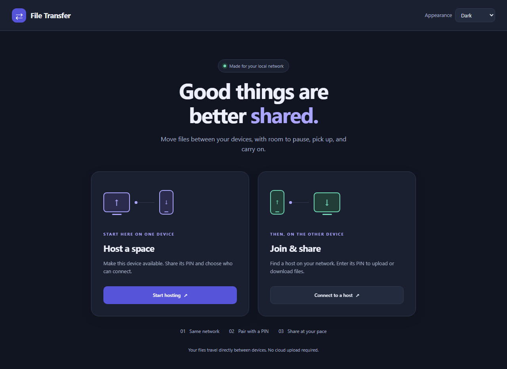
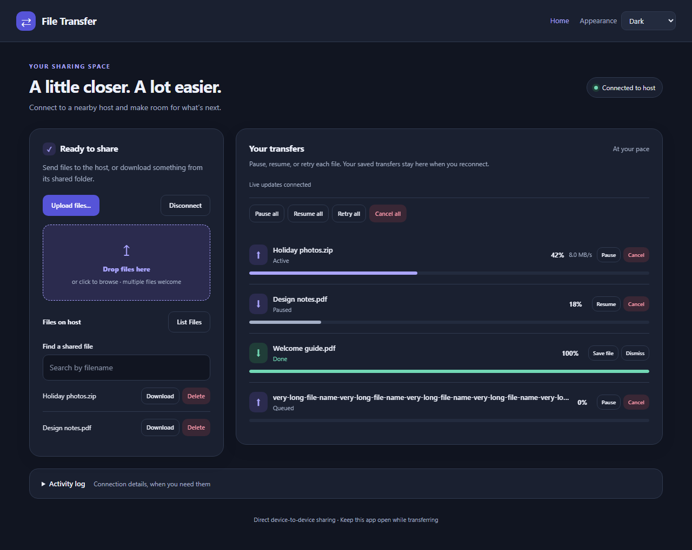
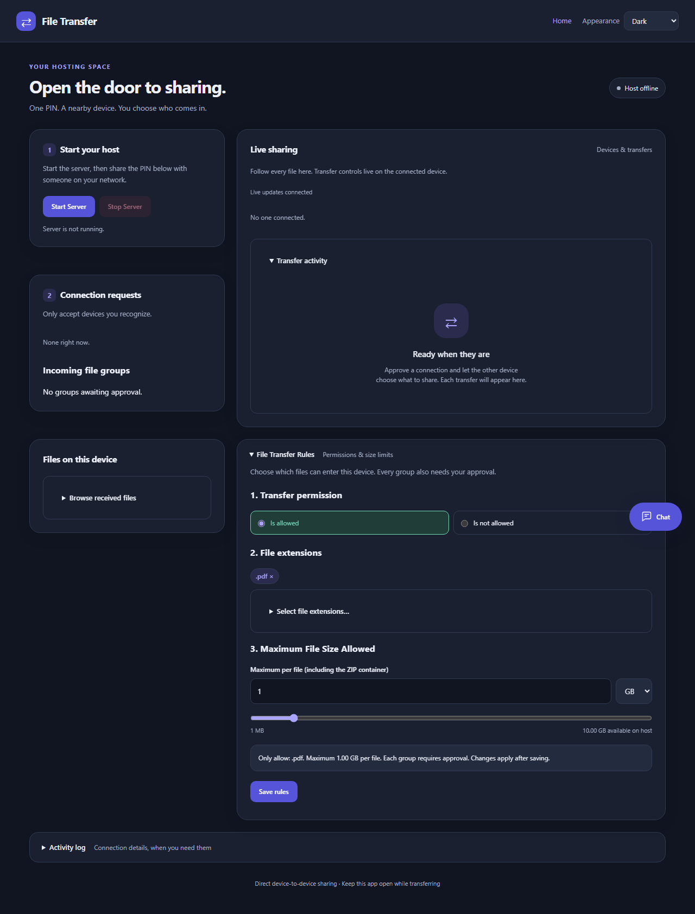
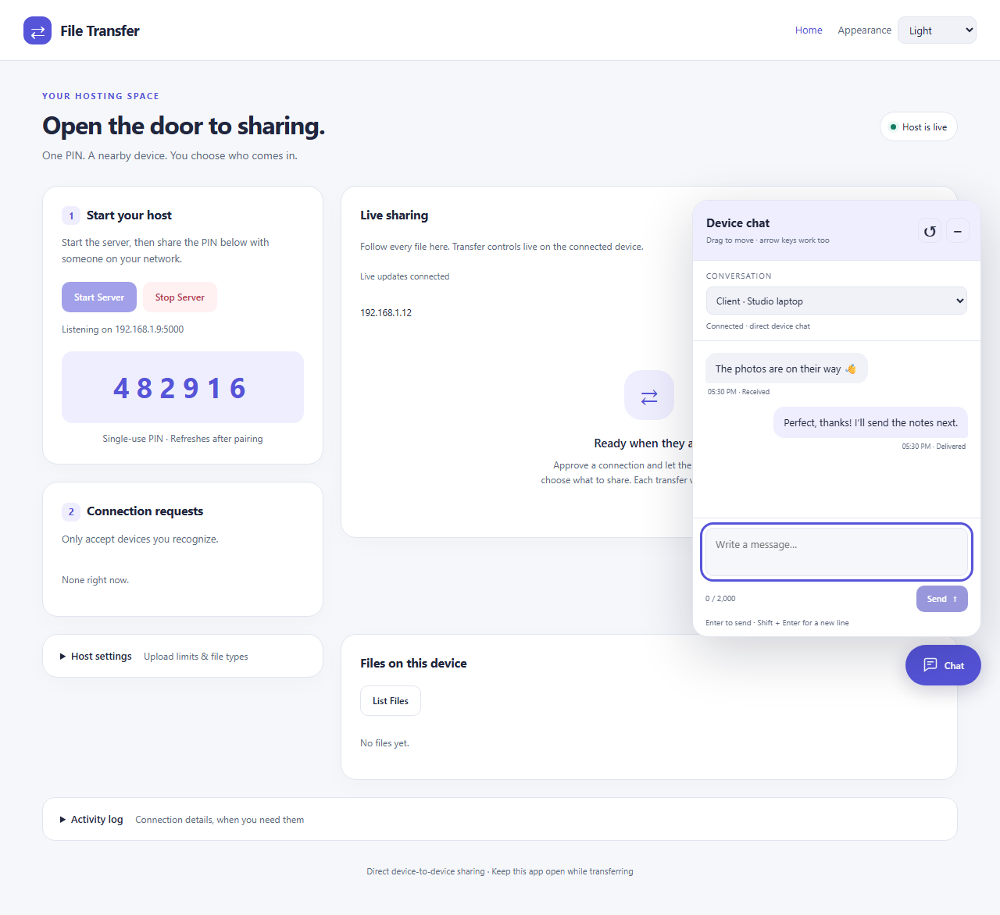
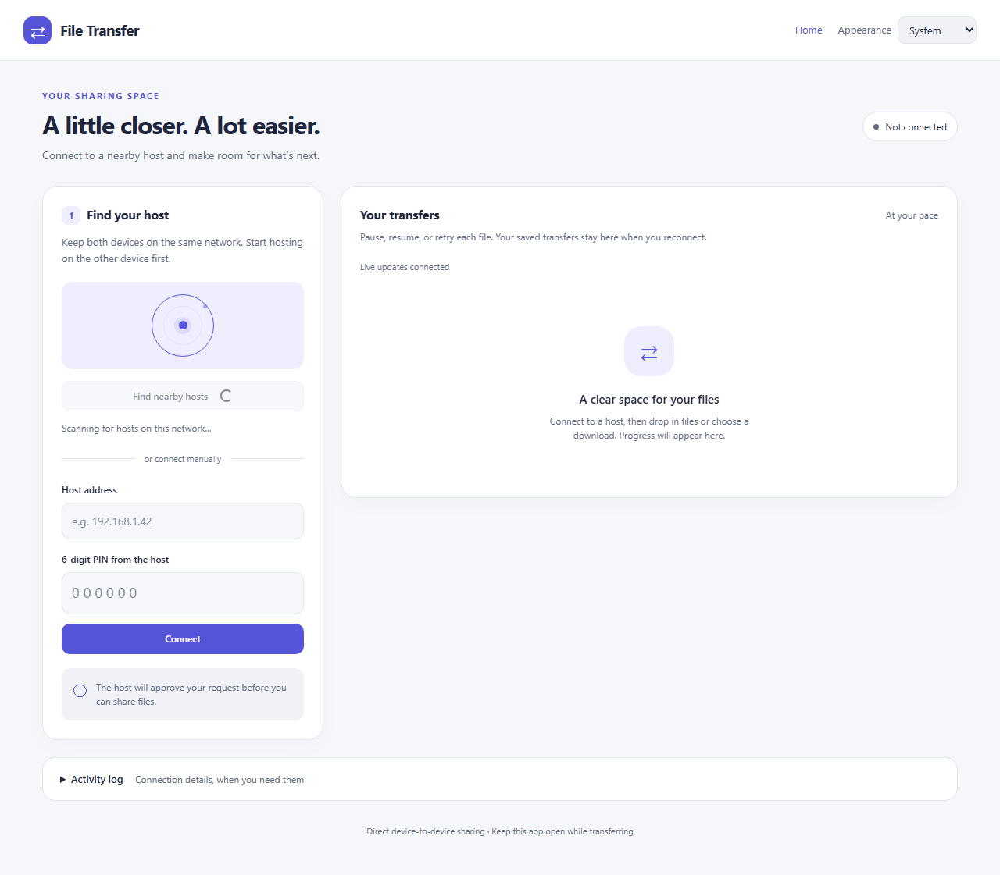
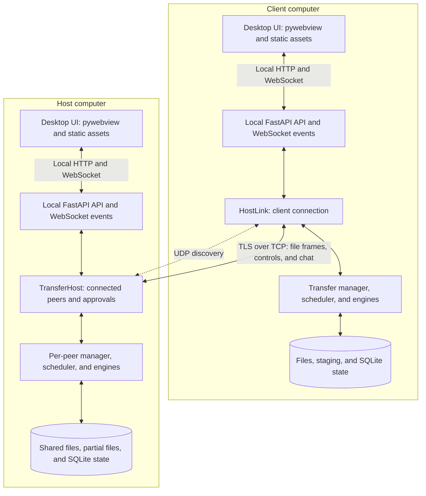
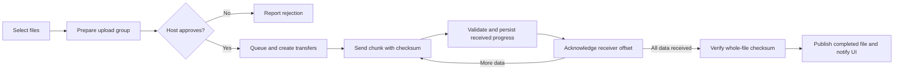

# File Transfer

Local file sharing with clear permissions, recoverable transfers, and device-to-device chat.

File Transfer is a desktop application for sharing files between computers on a
local network. One computer hosts a sharing session; clients discover it, establish
an approved connection, and upload or download files through a visual queue. Files
travel directly between devices over TLS, without a cloud upload relay.

The interface combines a native desktop window with a local web application. It
provides host-side receiving rules, approval for each selected upload group,
optional ZIP packaging, individual and bulk transfer controls, and live progress.

[Get started](#install-run-and-test) · [Features](#key-features) ·
[Screenshots](#application-preview) · [Architecture](#project-architecture) ·
[Project structure](#project-structure) · [Tech stack](#tech-stack)



*Application UI preview. Screenshots use illustrative browser-test data; see the
[preview notes](demo/README.md).*

## Key features

| Capability | What it provides |
| --- | --- |
| Nearby discovery | Find hosts on the local network, or enter an address manually. |
| Approved connections | Certificate fingerprint verification, a single-use PIN, and host approval protect pairing. |
| Group approval | The host accepts or rejects a selected upload group instead of approving each file separately. |
| Receiving rules | Allow or deny selected extensions, add custom extensions, and set a per-file size limit with synchronized slider and numeric controls. |
| Concurrent queue | Up to five active file transfers per peer by default, with queued work scheduled as capacity becomes available. |
| Transfer controls | Pause, resume, cancel, or retry individual transfers; bulk controls manage the queue. |
| Integrity and recovery | Chunk and whole-file SHA-256 checks, persistent transfer metadata, and receiver-authoritative resume offsets. |
| Optional ZIP delivery | Send a selection as a compressed archive; its contents must still satisfy host rules. Archives are not automatically extracted. |
| Human-to-human chat | A movable chat panel lets connected users coordinate without a separate messaging app. This is not an AI chatbot. |
| Responsive presentation | Light, dark, and system appearance; compact transfer lists; progress animations and reduced-motion support. |

One host can serve multiple clients. Each client connection targets one host at a
time. The five-transfer default is per peer, not a host-wide limit on all clients.

## What distinguishes this design

The value is in the combination of explicit receiving permission and practical
transfer control—not a claim that these capabilities are exclusive to this project.

- **Permission at two levels:** approving a device does not automatically approve
  every later upload selection. The host remains in control of each group.
- **Transfer isolation:** file operations are identified independently inside a
  shared connection, so cancelling a file does not require disconnecting the peer.
- **Recovery tied to received data:** the receiver determines the usable resume
  offset; local persistence records transfer state across reconnects and restarts.
- **Disk-backed data handling:** browser uploads are staged to disk and network
  transfers use bounded chunks. The design does not require an entire file in RAM.
- **Local-first operation:** after installation, sharing does not depend on a cloud
  storage account or upload service. Local networking and firewall access are still required.
- **Inspectable implementation:** plain HTML/CSS/JavaScript, a Python backend,
  explicit protocol frames, and focused tests make the system approachable to study.

## Application preview

These images are application UI captures using deterministic test fixtures.
Names, messages, PINs, percentages, and rates shown are examples—not live
credentials or measured performance. Exact controls and layout may differ from
the installed build. Static images do not demonstrate animation or verify a real
network exchange.

### Transfer queue

Individual progress, transfer states, upload controls, and bulk actions in the dark theme.



### Host controls and file transfer rules

Host-side connection and group approval areas, extension selection, a size limit,
and a live rules summary.



### Device chat and light appearance

A movable chat panel keeps conversations alongside sharing controls.



### Searching for nearby hosts

A still capture of the radar-style host-search animation while discovery is in progress.
This PNG shows the searching state; it is not an animated recording.



## Project architecture

Each computer runs its own desktop UI and local API. The local HTTP/WebSocket
connection serves the interface; it is separate from the TLS-protected TCP
connection used between computers. Discovery uses UDP on the local network.



The diagram represents one client; additional clients have independent peer
sessions on the host. Managers own transfer lifecycles, schedulers admit queued
work, and engines move and validate file chunks. A session routes frames by
transfer ID. SQLite stores metadata; file contents remain on disk.

### How a transfer reaches disk



The upload path stages browser-selected content into seekable files before network
sending. Optional ZIP creation also needs disk space. The diagram omits error,
pause, and reconnect branches; the technical guides document those contracts.
Acknowledgements are stop-and-wait per transfer: concurrency comes from multiple
transfers, not multiple unacknowledged chunks within one file.

| Boundary | Responsibility |
| --- | --- |
| Desktop UI → local API | Authorized local UI requests, input validation, and progress events. The API is not intended for public Internet hosting. |
| Client → host | TLS identity verification, PIN authentication, host approval, and multiplexed transfer/control messages. |
| Approved group → individual files | Receiving rules and transfer creation still apply; group approval is not permission to bypass validation. |
| Memory → disk | Bounded buffers and flow-control budgets; staged, partial, and completed file data consume disk capacity. |
| Disconnect → recovery | Persisted metadata and peer reconciliation enable recovery; unfinished browser staging is not guaranteed to survive restart. |

## Tech stack

| Layer | Technology | Role |
| --- | --- | --- |
| Core runtime | Python | Transfer state, file I/O, scheduling, threading, and recovery. |
| Local service | FastAPI, Uvicorn, Pydantic | HTTP endpoints, validated requests, and WebSocket events. |
| Desktop shell | pywebview; WebView2 on Windows | Native application window hosting the local interface. |
| Frontend | HTML, CSS, vanilla JavaScript | Responsive UI, theme controls, queues, rules, and chat without a frontend build step. |
| Peer networking | TCP sockets, TLS, UDP discovery | Direct file/control exchange and nearby host discovery. |
| Identity and integrity | Python `ssl`, `cryptography`, SHA-256 | TLS certificates, fingerprint checks, and data-integrity validation. |
| Persistence and archives | SQLite, filesystem, Python `zipfile` | Transfer metadata, disk-backed file storage, and optional ZIP preparation. |
| Verification | pytest, HTTPX, Playwright/Chromium, Node.js test runner | Backend, API, UI, and JavaScript testing. |
| Distribution | PyInstaller and repository packaging tools | Executable builds, source bundles, and release smoke checks. |

The pinned release environment targets **Windows x64 / Python 3.14.4**. That is a
validation target, not a claim of equivalent support on every operating system.
The setup below distinguishes running the application from installing the larger
test toolchain.

## Install, run, and test

### 1. Download the project and check prerequisites

Download the repository using GitHub's **Code → Download ZIP**, then extract it.
Alternatively, clone the repository using its Git URL. Open PowerShell in the
extracted or cloned project root—the folder containing `launch.py`, `requirements.txt`
and the `tools` directory. Do not run the project from inside an unopened ZIP.

Prerequisites:

- **Windows x64 and Python 3.14.4** for the pinned runtime/build environment.
  Other Python versions and operating systems need separate validation.
- A functioning **Microsoft Edge WebView2 Runtime** for the Windows desktop window.
- Internet access for initial dependency installation.
- Several GB of free disk space for dependencies, browser installation and testing,
  plus capacity for selected files and ZIP preparation. **500 MB free is not enough
  for the complete verification suite.** Required space varies with the workload.
- **Node.js** for JavaScript tests. It is not required just to launch the Python app.

Adjust the example path to your actual folder. GitHub ZIP downloads may have a
branch suffix in the extracted folder name.

```powershell
cd "C:\Users\YOUR_USERNAME\Desktop\filetransfer2"
python --version
```

### 2. Set up the application environment

Create the virtual environment once, then install the pinned dependencies:

```powershell
python -m venv .venv
.\.venv\Scripts\python.exe -m pip install --upgrade pip
.\.venv\Scripts\python.exe -m pip install -r requirements-release-lock.txt
.\.venv\Scripts\python.exe -m pip check
```

These commands use the virtual environment directly; activation is unnecessary.
The release lock targets Windows x64 / Python 3.14.4 and includes runtime/build
dependencies. It is not a complete development lock or a vulnerability audit.
`pip check` checks installed dependency compatibility, not security advisories.

For normal use, proceed to launching the application. Browser-test dependencies
are only needed if you also want to run the tests.

### 3. Run the application

```powershell
.\.venv\Scripts\python.exe launch.py
```

Use this command on subsequent launches; there is no need to reinstall dependencies
each time. Launch through the desktop entry point, not by opening HTML files or
navigating directly to the local HTTP port. The launcher establishes the authorized
local UI session. Keep the UI service bound to loopback; do not expose it publicly.

To share files between computers:

1. Launch the application on both computers on the intended private network.
2. On the receiving computer, open **Host**, configure receive rules and start hosting.
3. On the sending computer, discover/select the host or enter its network address.
4. Verify the host's full certificate fingerprint through a trusted channel, enter
   its current PIN and wait for the host to approve the connection.
5. Select files, optionally enable ZIP packaging, and have the host approve the group.
6. Keep both applications open until transfers complete.

Allow the relevant private-network firewall access if required. Discovery can be
blocked even when manual address entry works. See [Quick start](01-Use-the-application/QUICK_START.md),
[Host guide](01-Use-the-application/HOST_GUIDE.md) and
[Client guide](01-Use-the-application/CLIENT_GUIDE.md) for details.

### 4. Install testing dependencies

If you want to verify the project locally, run:

```powershell
.\.venv\Scripts\python.exe -m pip install -r requirements-dev.txt -c requirements-release-lock.txt
.\.venv\Scripts\python.exe -m playwright install chromium
.\.venv\Scripts\python.exe -m pip check
node --version
```

The constraints preserve the pinned runtime/build package versions while adding
development tools. The development-only packages are not all pinned by that file.
If pip reports a dependency conflict, retain its error output rather than silently
discarding the constraints. If `node` is not recognized, install Node.js and reopen
PowerShell before running JavaScript or complete-suite verification.

Playwright Chromium is for automated browser tests; it is distinct from the
WebView2 runtime used by the desktop window. **Close the application before testing**
to avoid port conflicts. Tests require writable temporary storage and, for native
integration, working local networking and subprocess creation.

### 5. Check test collection

```powershell
.\.venv\Scripts\python.exe -m pytest --collect-only -q
```

The current project should collect **721 Python test cases** with the testing
dependencies installed. Collection checks test discovery/imports; it does not
execute the tests or establish that they pass. Shared fixtures live in
`tests/helpers/`; the runnable cases remain in `tests/test_*.py`.

### 6. Run complete verification

Only run this after making sufficient disk space available:

```powershell
.\.venv\Scripts\python.exe tools/verify_all.py --output ..\verification-local-01
```

This runs Python, browser, local-load and Node checks, including opt-in load and
upload measurements. Allow several minutes; the sustained local soak alone lasts
approximately three minutes. Timing varies with the machine and storage.

**The output directory must not already exist.** Use `verification-local-02` for
another run. The relative path above creates the reports beside the project folder.

```text
verification-local-01/
├── python.log
├── python.xml
├── node.log
├── runtime.log
└── tmp/
```

The runner stops if a suite fails, so later reports may not exist. It also rejects
skipped required Python cases. A timeout, missing Chromium or blocked local socket
is not a successful verification result. Read `python.log` or `node.log` for the
underlying failure. Keep reports and test-generated data out of Git.

## Use the application

- [Product overview](01-Use-the-application/PRODUCT_OVERVIEW.md)
- [Quick start](01-Use-the-application/QUICK_START.md)
- [Host guide](01-Use-the-application/HOST_GUIDE.md)
- [Client guide](01-Use-the-application/CLIENT_GUIDE.md)
- [Discovery and pairing](01-Use-the-application/DISCOVERY_AND_PAIRING.md)
- [File transfers](01-Use-the-application/FILE_TRANSFERS.md)
- [Group approval](01-Use-the-application/GROUP_APPROVAL.md)
- [ZIP packaging](01-Use-the-application/ZIP_PACKAGING.md)
- [Transfer rules](01-Use-the-application/TRANSFER_RULES.md)
- [Queue and bulk actions](01-Use-the-application/QUEUE_AND_BULK_ACTIONS.md)
- [Device chat](01-Use-the-application/CHAT.md)
- [Appearance and accessibility](01-Use-the-application/APPEARANCE_AND_ACCESSIBILITY.md)

## Understand and integrate

- [Architecture](02-Understand-and-integrate/ARCHITECTURE.md)
- [Wire protocol](02-Understand-and-integrate/PROTOCOL.md)
- [Transfer lifecycle](02-Understand-and-integrate/TRANSFER_LIFECYCLE.md)
- [Concurrency and flow control](02-Understand-and-integrate/CONCURRENCY_AND_FLOW_CONTROL.md)
- [Storage and recovery](02-Understand-and-integrate/STORAGE_AND_RECOVERY.md)
- [API reference](02-Understand-and-integrate/API_REFERENCE.md)
- [Event delivery](02-Understand-and-integrate/EVENTS.md)
- [Configuration](02-Understand-and-integrate/CONFIGURATION.md)
- [Security](02-Understand-and-integrate/SECURITY.md)
- [Operating-system concepts](OPERATING_SYSTEM_CONCEPTS.md)
- [Computer-networking concepts](COMPUTER_NETWORK_CONCEPTS.md)

## Validate and operate

- [Testing](03-Validate-and-operate/TESTING.md)
- [Test organization and shared helpers](tests/README.md)
- [Performance](03-Validate-and-operate/PERFORMANCE.md)
- [Production deployment](03-Validate-and-operate/PRODUCTION_DEPLOYMENT.md)
- [Build and packaging](03-Validate-and-operate/BUILD_AND_PACKAGING.md)
- [Operations and backup](03-Validate-and-operate/OPERATIONS.md)
- [Troubleshooting](03-Validate-and-operate/TROUBLESHOOTING.md)
- [Release checklist](03-Validate-and-operate/RELEASE_CHECKLIST.md)
- [Known limitations](03-Validate-and-operate/KNOWN_LIMITATIONS.md)
- [Developer guide](03-Validate-and-operate/DEVELOPER_GUIDE.md)
- [Glossary](03-Validate-and-operate/GLOSSARY.md)

**Rules** sections describe required behavior or operational precautions. Defaults
and hard limits are labelled separately from measured benchmark observations.
**Verify** sections run from the application source root after installing development
dependencies and Chromium where needed. No commands execute from this documentation
directory. A focused test command does not replace full release verification.

Measurements in Performance and Testing identify their evidence and sample scope.
Document editing did not rerun benchmarks or certify a different machine. Feature
and technical guides are organized in the three documentation folders; the concept
guides are at the project root, and the test-layout guide is in `tests/README.md`.
